# RHLabs Design System

> Guia de implementação do Design System do **RHLabs** para o time de desenvolvimento.
> Tudo o que foi desenhado no Figma (tokens, estilos e componentes) explicado de um jeito que dá para copiar para o código.

[](https://www.figma.com/design/THYVm23rQLtJB4rxUKVMUl/RHLabs)


**Fonte da verdade:** [arquivo RHLabs no Figma](https://www.figma.com/design/THYVm23rQLtJB4rxUKVMUl/RHLabs). Este README documenta o que está lá. Se houver divergência, vale o Figma, e vale abrir uma issue para corrigir este documento.

---

## Código pronto: biblioteca e catálogo

Esta pasta é um **projeto de verdade**, não só documentação: tem os componentes do núcleo escritos em **React + TypeScript + Tailwind v4** o **Storybook do RHLabs** para ver cada um funcionando (mudando as props na hora) e conferir a documentação, além de um catálogo mais simples com demos e código para copiar.

### Storybook (para o time de desenvolvimento)

O jeito principal de explorar os componentes é o **Storybook do RHLabs**: a lista de componentes fica à esquerda, cada variação é uma "story" e o painel **Controls** deixa mudar as props na hora, vendo o resultado e as animações (por exemplo, o Accordion abrindo e fechando).

```bash
cd design-system
npm install
npm run storybook
```

Abre em `http://localhost:6006`, **só no computador de quem rodou o comando**. Nada é publicado na internet.

#### Veja em ação

Os GIFs abaixo são capturas **reais do nosso Storybook**, mostradas passo a passo (cada quadro é um estado do componente). No GitHub não dá para clicar neles: para mexer de verdade, rode `npm run storybook`.

**Accordion**, com vários itens abertos ao mesmo tempo (story "Permite vários"):

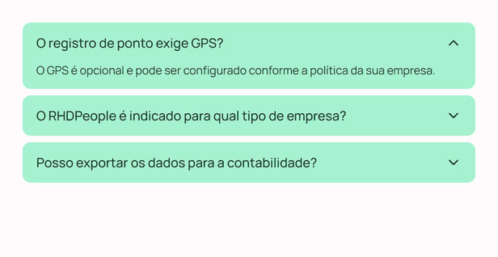

**Button** em loading: ao clicar, mostra o spinner e ignora novos cliques (story "Loading interativo"):

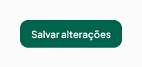

**Dropdown**: abre com um clique, destaca o item sob o mouse e marca itens com check (story "Menu de conta"):

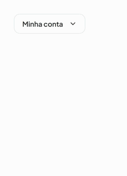

**Select**: abre a lista, mostra a opção desabilitada esmaecida e exibe o valor escolhido (story "Controlado"):

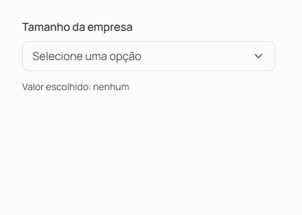

**Input** com validação ao vivo: erro enquanto o e-mail está incompleto e sucesso quando fica válido (story "Validação ao vivo"):

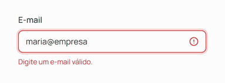

**Tema Light e Dark**: os mesmos componentes trocando de tema pela barra de ferramentas (story "Variants" do Button):

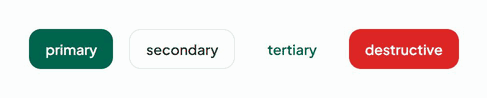

> Os GIFs são fotos do momento em que foram gerados. Se um componente mudar, eles podem ficar desatualizados. O Storybook sempre reflete o código atual.

O que tem lá:

- **Stories** de cada componente: Playground, variantes, tamanhos, estados e exemplos interativos.
- **Controls**: muda props (variant, size, error, loading…) e o componente reage.
- **Docs**: página gerada com a descrição, o link para o componente no Figma, a tabela de props e todas as stories.
- **Tema Light / Dark** na barra de ferramentas do topo (ícone de círculo).
- **Accessibility**: checagem automática de acessibilidade de cada story.

`npm run build-storybook` gera a versão estática em `storybook-static/` (não é versionada no Git). As stories ficam em `src/stories/`, separadas dos componentes em `src/components/ui/`, para não irem junto na hora de copiar.

### Rodar o catálogo

Além do Storybook existe o **catálogo** do projeto (mais simples, com demos, props e código para copiar):

```bash
npm run dev
```

Abre em `http://localhost:5173`. No catálogo você encontra:

- **Demos ao vivo** de cada componente (passe o mouse, use Tab, digite nos campos).
- **Troca Light / Dark** no topo, com os valores reais de cada token.
- **Tabela de props** com o nome da propriedade equivalente no Figma.
- **Código para copiar**, pronto para colar.
- Páginas de **Cores, Tipografia, Raio e espaçamento**.

`npm run build` gera uma versão estática em `dist/` (usa caminhos relativos, funciona em qualquer hospedagem). `npm run typecheck` confere os tipos. Requer Node 20.19 ou superior.

### Ver o catálogo sem servidor (arquivo único)

Para mostrar o catálogo a quem não vai instalar nada (design, produto, stakeholders), gere o catálogo inteiro em **um único arquivo HTML**:

```bash
npm run build:standalone
```

O resultado fica em `dist-standalone/catalog.html`. Abra com **duplo clique** no navegador: tudo funciona (botões, campos, Select, Dropdown, troca Light/Dark), sem `npm`, sem servidor e sem outros arquivos. Dá para mandar por e-mail ou chat. As fontes vêm do Google Fonts; sem internet o catálogo abre com fontes do sistema.

Eu testei o arquivo servido por um servidor local (um único pedido, sem depender de outros arquivos), em Light, Dark e no tamanho de celular. Se algum navegador bloquear algo ao abrir direto do disco, sirva a pasta com `npx serve dist-standalone` e abra `catalog.html`.

O arquivo é gerado a partir do código atual, então gere de novo quando os componentes mudarem. Ele não é versionado no Git (`dist-standalone/` está no `.gitignore`).

### O que já está em código

| Componente | Arquivo | Origem no Figma | Usa Radix |
|---|---|---|---|
| Button, Icon button | `src/components/ui/button.tsx` | `18:81254`, `18:82644` | não |
| Input | `src/components/ui/input.tsx` | `18:77197` | não |
| Textarea | `src/components/ui/textarea.tsx` | `26:131` | não |
| Select | `src/components/ui/select.tsx` | `29:131` | sim |
| Checkbox | `src/components/ui/checkbox.tsx` | `11:350` | sim |
| Radio | `src/components/ui/radio-group.tsx` | `1:11475` | sim |
| Badge | `src/components/ui/badge.tsx` | `11:403` | não |
| Status | `src/components/ui/status.tsx` | `181:88` | não |
| Avatar | `src/components/ui/avatar.tsx` | `1:11694` | não |
| Alert | `src/components/ui/alert.tsx` | `241:7411` | não |
| Accordion | `src/components/ui/accordion.tsx` | `108:21534` | sim |
| Dropdown | `src/components/ui/dropdown-menu.tsx` | `30:3160`, `30:3251` | sim |

O [Radix UI](https://www.radix-ui.com/) cuida de teclado, foco e ARIA nos componentes que abrem, fecham ou têm seleção (Select, Dropdown, Accordion, Checkbox, Radio). Os estilos continuam sendo os tokens do Figma.

**Ainda não estão em código:** Tag input, Choice chip, Radio card, Segmented control, Stepper, Rating, Nav link, os componentes do App e os de Layout (sidebar, headers, footer). Eles seguem o mesmo padrão: use as fichas deste README e o código dos componentes acima como modelo.

### Estrutura

```
design-system/
├── .storybook/               ← configuração do Storybook (tema Light/Dark, fontes, addons)
├── index.html
├── package.json
├── vite.config.ts
└── src/
    ├── styles/
    │   ├── tokens.css        ← tokens do tema (Light e Dark), vêm do Figma
    │   └── index.css         ← liga os tokens ao Tailwind (@theme) e define raios e fontes
    ├── lib/cn.ts             ← junta classes e resolve conflitos do Tailwind
    ├── components/ui/        ← os componentes (copiar para o projeto)
    ├── stories/              ← as stories do Storybook (não copiar para o projeto)
    └── catalog/              ← o catálogo (não precisa ir para o projeto)
```

### Levar para o projeto de vocês

O padrão é **copy-paste**, igual ao shadcn/ui: os componentes viram código de vocês, sem pacote para atualizar.

1. Copie `src/styles/tokens.css` e o bloco `@theme inline` de `src/styles/index.css` para o CSS global.
2. Copie `src/lib/cn.ts` e a pasta `src/components/ui/`.
3. Instale as dependências:

   ```bash
   npm i class-variance-authority clsx tailwind-merge lucide-react \
     @radix-ui/react-accordion @radix-ui/react-checkbox @radix-ui/react-dropdown-menu \
     @radix-ui/react-radio-group @radix-ui/react-select
   ```

4. Carregue as fontes Manrope e Plus Jakarta Sans (veja o [Quickstart](#2-comece-por-aqui-quickstart)).
5. Se o projeto usa alias, ajuste os imports relativos (`../../lib/cn`) para o alias de vocês.

```tsx
import { Button, Input, Select, Checkbox, Alert } from "@/components/ui";

<Button variant="primary" size="md">Salvar</Button>
```

### Como foi validado

- `tsc --noEmit` e `vite build` passam sem erro.
- O Storybook sobe (`npm run storybook`) e o build estático (`npm run build-storybook`) passa numa cópia limpa. Conferi no navegador: Controls mudando props, tema Dark, a página Docs e o Accordion com "permite vários".
- `npm audit` aponta 4 avisos moderados em dependências internas do próprio Storybook (`glob` e `minimatch`, usadas só em desenvolvimento, não vão para o produto). A correção automática derrubaria o Storybook para a versão 8, então não foi aplicada. Vale reavaliar quando sair uma versão nova.
- Conferido no navegador, em Light e Dark, contra o Figma: Button, Input, Select, Dropdown, Status, Accordion, Avatar e as cores.
- **Não há testes automatizados** nem teste com leitor de tela. Recomendado antes de ir para produção.
- Medidas e tokens foram lidos do Figma para todos os componentes da tabela acima. Alguns valores o Figma não define e foram **inferidos**: tamanho dos ícones do Icon button, opacidade do Radio desabilitado (50%, igual ao Checkbox), cores de Warning e Info do Status em Dark, aparência do placeholder do Avatar e o espaço entre itens do Accordion (8px). Vale o design confirmar.

---

## Sumário

**Novo:** [Código pronto: biblioteca e catálogo](#código-pronto-biblioteca-e-catálogo)

1. [Visão geral](#1-visão-geral)
2. [Comece por aqui (quickstart)](#2-comece-por-aqui-quickstart)
3. [Como o arquivo Figma está organizado](#3-como-o-arquivo-figma-está-organizado)
4. [Como ler o Figma e traduzir para código](#4-como-ler-o-figma-e-traduzir-para-código)
5. [Foundations](#5-foundations)
   - [Logo](#51-logo) · [Cores](#52-cores) · [Tipografia](#53-tipografia) · [Border radius](#54-border-radius) · [Espaçamento](#55-espaçamento) · [Grid e layout](#56-grid-e-layout) · [Foco, sombras e estados](#57-foco-sombras-e-estados) · [Ícones](#58-ícones) · [Dark mode](#59-dark-mode)
6. [Catálogo de componentes](#6-catálogo-de-componentes)
   - [Ações](#ações) · [Formulários](#formulários) · [Feedback e dados](#feedback-e-dados) · [Navegação e conteúdo](#navegação-e-conteúdo) · [Componentes do App](#componentes-do-app) · [Layout](#componentes-de-layout)
7. [Acessibilidade](#7-acessibilidade)
8. [Pontos de atenção (leia antes de implementar)](#8-pontos-de-atenção-leia-antes-de-implementar)
9. [Checklist para implementar um componente](#9-checklist-para-implementar-um-componente)
10. [Governança e equipe](#10-governança-e-equipe)

---

## 1. Visão geral

O RHLabs Design System dá base visual e de interface ao produto de gestão de Departamento Pessoal (no rodapé do site aparece como **RHDPeople**): landing page, login e cadastro, portal do colaborador (desktop e mobile) e páginas legais (termos, LGPD e cookies).

### Princípios

| Princípio | O que significa na prática |
|---|---|
| **Tokens primeiro** | Cor, espaço, raio e tipografia vêm de variáveis. Nada de valor solto no código. |
| **Três camadas de cor** | `Primitives` → `Theme` → componentes. Telas usam **só** `Theme`. |
| **Light e Dark nativos** | Todo token do `Theme` tem os dois modos. Dark mode não é um "extra". |
| **Padrão shadcn/ui + Tailwind** | Os nomes dos tokens seguem o shadcn (`--background`, `--primary`, `--ring`…), então o mapeamento para código é direto. |
| **Estado nunca só por cor** | Erro, sucesso e seleção sempre combinam cor com ícone, texto ou forma. |

### Stack alvo (assumida)

O Figma declara que o sistema de cores segue **shadcn/ui com Tailwind**. Os exemplos deste README usam **React + TypeScript + Tailwind CSS v4 + shadcn/ui (cva)**. Se o projeto usar outra stack, as variáveis CSS da [seção 2](#2-comece-por-aqui-quickstart) continuam valendo, e só muda a camada de componentes.

> Os componentes do núcleo **já existem em código** nesta pasta (veja [Código pronto](#código-pronto-biblioteca-e-catálogo)). Os trechos de código das fichas abaixo são versões resumidas. Para os componentes que ainda não foram codificados, tratem-nos como **propostas de implementação** derivadas do Figma.

---

## 2. Comece por aqui (quickstart)

Em 5 passos você tem a base visual do sistema no projeto.

### Passo 1. Fontes

Duas famílias, mais uma mono para código:

| Papel | Família | Pesos usados | Onde usar |
|---|---|---|---|
| **Primária** (títulos) | Plus Jakarta Sans | 500, 600, 700, 800 | Títulos, botões, navegação, números em destaque |
| **Secundária** (texto) | Manrope | 400, 500, 600, 700 | Parágrafos, formulários, tabelas, mensagens auxiliares |
| **Mono** | Geist Mono | 500 | Código inline (`Code/Inline`) |

```html
<link rel="preconnect" href="https://fonts.googleapis.com">
<link rel="preconnect" href="https://fonts.gstatic.com" crossorigin>
<link href="https://fonts.googleapis.com/css2?family=Manrope:wght@400;500;600;700&family=Plus+Jakarta+Sans:wght@500;600;700;800&display=swap" rel="stylesheet">
```

### Passo 2. Tokens de tema (CSS)

Copie para o CSS global (por exemplo `src/styles/tokens.css`). Os valores vêm da coleção **Theme** do Figma, já resolvidos para hex.

```css
:root {
  /* Superfícies */
  --background: #FFFFFF;
  --foreground: #2D2D2D;
  --foreground-secondary: #505050;
  --card: #FFFFFF;
  --card-foreground: #2D2D2D;
  --popover: #FFFFFF;
  --popover-foreground: #2D2D2D;
  --muted: #F2F2F2;
  --muted-foreground: #64748B;
  --secondary: #F2F2F2;
  --secondary-foreground: #2D2D2D;

  /* Marca e ação */
  --primary: #00644E;
  --primary-foreground: #FFFFFF;
  --primary-hover: #004D40;
  --primary-pressed: #012F33;
  --accent: #F3FFFC;
  --accent-foreground: #012F33;

  /* Semânticas */
  --destructive: #DC2626;
  --destructive-foreground: #FFFFFF;
  --destructive-hover: #B91C1C;
  --destructive-pressed: #991B1B;
  --success: #00644E;
  --success-foreground: #FFFFFF;
  --warning: #D97706;
  --warning-foreground: #111111;
  --info: #346CC9;
  --info-foreground: #FFFFFF;

  /* Bordas, foco e desabilitado */
  --border: #E1EBE9;
  --input: #E1EBE9;
  --ring: #00644E;
  --ring-focus: rgb(0 100 78 / 0.5);
  --ring-error: rgb(220 38 38 / 0.2);
  --disabled: #E5E5E5;
  --disabled-foreground: #737373;

  /* Gráficos */
  --chart-1: #059669;
  --chart-2: #3A84FF;
  --chart-3: #D97706;
  --chart-4: #E84045;
  --chart-5: #9CA3AF;

  /* Sidebar */
  --sidebar: #FAFAFA;
  --sidebar-foreground: #2D2D2D;
  --sidebar-primary: #00644E;
  --sidebar-primary-foreground: #FFFFFF;
  --sidebar-accent: #F3FFFC;
  --sidebar-accent-foreground: #012F33;
  --sidebar-border: #E1EBE9;
  --sidebar-ring: #00644E;
}

.dark {
  --background: #111111;
  --foreground: #FFFFFF;
  --foreground-secondary: #D9D9D9;
  --card: #171717;
  --card-foreground: #FFFFFF;
  --popover: #1D1D1D;
  --popover-foreground: #FFFFFF;
  --muted: #262626;
  --muted-foreground: #D9D9D9;
  --secondary: #262626;
  --secondary-foreground: #FAFAFA;

  --primary: #059669;
  --primary-foreground: #FFFFFF;
  --primary-hover: #047857;
  --primary-pressed: #065F46;
  --accent: rgb(5 150 105 / 0.25);
  --accent-foreground: #6EE7B7;

  --destructive: #E84045;
  --destructive-foreground: #FFFFFF;
  --destructive-hover: #DC2626;
  --destructive-pressed: #B91C1C;
  --success: #059669;
  --success-foreground: #FFFFFF;
  --warning: #CA8A04;
  --warning-foreground: #111111;
  --info: #3A84FF;
  --info-foreground: #FFFFFF;

  --border: rgb(255 255 255 / 0.1);
  --input: rgb(255 255 255 / 0.1);
  --ring: #059669;
  --ring-focus: rgb(5 150 105 / 0.5);
  --ring-error: rgb(232 64 69 / 0.4);
  --disabled: #262626;
  --disabled-foreground: #737373;

  --chart-1: #34D399;
  --chart-2: #3A84FF;
  --chart-3: #CA8A04;
  --chart-4: #E84045;
  --chart-5: #9CA3AF;

  --sidebar: #171717;
  --sidebar-foreground: #FFFFFF;
  --sidebar-primary: #059669;
  --sidebar-primary-foreground: #FFFFFF;
  --sidebar-accent: rgb(5 150 105 / 0.25);
  --sidebar-accent-foreground: #6EE7B7;
  --sidebar-border: rgb(255 255 255 / 0.1);
  --sidebar-ring: #059669;
}
```

### Passo 3. Conectar ao Tailwind (v4)

```css
@import "tailwindcss";
@custom-variant dark (&:is(.dark *));

@theme inline {
  /* Cores: cada token vira uma utility (bg-primary, text-muted-foreground, border-border…) */
  --color-background: var(--background);
  --color-foreground: var(--foreground);
  --color-foreground-secondary: var(--foreground-secondary);
  --color-card: var(--card);
  --color-card-foreground: var(--card-foreground);
  --color-popover: var(--popover);
  --color-popover-foreground: var(--popover-foreground);
  --color-primary: var(--primary);
  --color-primary-foreground: var(--primary-foreground);
  --color-primary-hover: var(--primary-hover);
  --color-primary-pressed: var(--primary-pressed);
  --color-secondary: var(--secondary);
  --color-secondary-foreground: var(--secondary-foreground);
  --color-muted: var(--muted);
  --color-muted-foreground: var(--muted-foreground);
  --color-accent: var(--accent);
  --color-accent-foreground: var(--accent-foreground);
  --color-destructive: var(--destructive);
  --color-destructive-foreground: var(--destructive-foreground);
  --color-destructive-hover: var(--destructive-hover);
  --color-destructive-pressed: var(--destructive-pressed);
  --color-success: var(--success);
  --color-success-foreground: var(--success-foreground);
  --color-warning: var(--warning);
  --color-warning-foreground: var(--warning-foreground);
  --color-info: var(--info);
  --color-info-foreground: var(--info-foreground);
  --color-border: var(--border);
  --color-input: var(--input);
  --color-ring: var(--ring);
  --color-disabled: var(--disabled);
  --color-disabled-foreground: var(--disabled-foreground);

  /* Fontes */
  --font-sans: "Manrope", system-ui, sans-serif;
  --font-heading: "Plus Jakarta Sans", system-ui, sans-serif;
  --font-mono: "Geist Mono", ui-monospace, monospace;

  /* Raios. Atenção: isto SOBRESCREVE os raios padrão do Tailwind */
  --radius-2xs: 4px;
  --radius-xs: 8px;
  --radius-sm: 10px;
  --radius-md: 12px;
  --radius-lg: 16px;
  --radius-xl: 18px;
}

body { font-family: var(--font-sans); background: var(--background); color: var(--foreground); }
h1, h2, h3, h4, button { font-family: var(--font-heading); }
```

> **Cuidado com o raio.** O Tailwind já tem `rounded-md`, `rounded-xl` etc. com outros valores (6px, 12px…). Ao declarar `--radius-*` acima, `rounded-xl` passa a ser **18px**, que é o que o Figma pede. Avisem o time antes de importar componentes de outras libs.

### Passo 4. Ícones

```bash
npm i lucide-react
```

O Figma usa a biblioteca **Lucide**. O layer `lucide/arrow-left` vira `ArrowLeft` no código. Detalhes na [seção 5.8](#58-ícones).

### Passo 5. Dark mode

Adicione a classe `dark` no `<html>` e persista a escolha do usuário. Veja a [seção 5.9](#59-dark-mode).

---

## 3. Como o arquivo Figma está organizado

O arquivo é dividido por separadores (`---`) em blocos. Quem vai implementar precisa mesmo das páginas de **Foundations** e **Components**.

| Bloco | Páginas | Para que serve |
|---|---|---|
| **⚠️ Importante** | Capa (`Versão 1.0`, "Abril - atual 2026"), How to Use, Rules, Team | Regras de uso do arquivo e contato da equipe |
| **🎨 Foundations** | [Logo](https://www.figma.com/design/THYVm23rQLtJB4rxUKVMUl/RHLabs?node-id=2-7) · [Colors](https://www.figma.com/design/THYVm23rQLtJB4rxUKVMUl/RHLabs?node-id=2-8) · [Typography](https://www.figma.com/design/THYVm23rQLtJB4rxUKVMUl/RHLabs?node-id=2-9) · [Border Radius](https://www.figma.com/design/THYVm23rQLtJB4rxUKVMUl/RHLabs?node-id=2-10) · [Spacing](https://www.figma.com/design/THYVm23rQLtJB4rxUKVMUl/RHLabs?node-id=2-11) · [Alerts](https://www.figma.com/design/THYVm23rQLtJB4rxUKVMUl/RHLabs?node-id=2-12) · [Grid & Layout](https://www.figma.com/design/THYVm23rQLtJB4rxUKVMUl/RHLabs?node-id=2-13) | Fundamentos visuais e tokens |
| **🧩 Components** | [Buttons](https://www.figma.com/design/THYVm23rQLtJB4rxUKVMUl/RHLabs?node-id=2-16) · [Inputs](https://www.figma.com/design/THYVm23rQLtJB4rxUKVMUl/RHLabs?node-id=2-17) · [Text area](https://www.figma.com/design/THYVm23rQLtJB4rxUKVMUl/RHLabs?node-id=2-18) · [Input selected](https://www.figma.com/design/THYVm23rQLtJB4rxUKVMUl/RHLabs?node-id=2-19) · [Dropdown](https://www.figma.com/design/THYVm23rQLtJB4rxUKVMUl/RHLabs?node-id=30-2112) · [Checkbox](https://www.figma.com/design/THYVm23rQLtJB4rxUKVMUl/RHLabs?node-id=2-20) · [Rating](https://www.figma.com/design/THYVm23rQLtJB4rxUKVMUl/RHLabs?node-id=2-21) · [Icons](https://www.figma.com/design/THYVm23rQLtJB4rxUKVMUl/RHLabs?node-id=2-22) · [Radio Buttons](https://www.figma.com/design/THYVm23rQLtJB4rxUKVMUl/RHLabs?node-id=2-23) · [Status](https://www.figma.com/design/THYVm23rQLtJB4rxUKVMUl/RHLabs?node-id=2-24) · [Accordion](https://www.figma.com/design/THYVm23rQLtJB4rxUKVMUl/RHLabs?node-id=108-21489) · [Navigation](https://www.figma.com/design/THYVm23rQLtJB4rxUKVMUl/RHLabs?node-id=109-2) · [Componentes do App](https://www.figma.com/design/THYVm23rQLtJB4rxUKVMUl/RHLabs?node-id=238-2) · [Layout](https://www.figma.com/design/THYVm23rQLtJB4rxUKVMUl/RHLabs?node-id=242-3798) · [Avatar](https://www.figma.com/design/THYVm23rQLtJB4rxUKVMUl/RHLabs?node-id=2-25) · [Badge](https://www.figma.com/design/THYVm23rQLtJB4rxUKVMUl/RHLabs?node-id=11-388) · [App Components](https://www.figma.com/design/THYVm23rQLtJB4rxUKVMUl/RHLabs?node-id=4-2) | Componentes reutilizáveis e suas variações |
| **🧠 Discovery** | Wireframes, Referências, Estrutura Landing Page | Pesquisa e estrutura (contexto, não implementação) |
| **💻 Prototypes** | Landing Page, Login e Cadastro, App Colaborador Mobile, App Colaborador Desktop, Legal | Telas finais montadas com o sistema |
| **📐 Handoff** | Fluxo 01 Landing · Fluxo 02 Login e Cadastro · Fluxo 03 App Colaborador · Fluxo 04 Termos, LGPD e Cookies | Fluxos para consulta durante o desenvolvimento |
| **📋 Spec: Portal do Colaborador** | Coerência Spec × App · Fluxos e UX · Perguntas em aberto | Especificação funcional do portal |

> **Atalho de dev:** para ver como um componente é usado de verdade, procure a tela nos **Prototypes** e nos **Handoff**.

---

## 4. Como ler o Figma e traduzir para código

### 4.1 Variáveis do Figma = tokens

O arquivo tem estas **coleções de variáveis**. As que importam estão em negrito.

| Coleção | Modos | Conteúdo | Usar? |
|---|---|---|---|
| **Primitives** | Value | Escalas de cor: `green`, `neutral`, `red`, `amber`, `blue`, `brand/*`, `status/*` | Só por dentro do Theme. Nunca direto em tela |
| **Theme** | Light · Dark | Tokens semânticos (`primary`, `border`, `ring`…) | **Sim, é a fonte das cores** |
| **Typography** | Value | Fontes, tamanhos, line-heights, pesos, letter-spacing | **Sim** |
| **Spacing** | Value | Escala de 4px (`spacing/0` a `spacing/32`) | **Sim** |
| **Radius** | Value | Escala de raios (`radius/2xs` a `radius/full`) | **Sim** |
| **Header e Footer** | Light · Dark | Tokens do header, footer, menu, cards de ajuda e CTA | **Sim**, nos componentes de layout |
| `Legacy / …` (Border Radius, Typography, Spacing, Color Tokens, Colors Primitives) | Mode 1 | Versão antiga dos tokens | **Não.** Só existe para não quebrar telas antigas |

### 4.2 Regra de ouro das cores

```
Primitive  (green/700, neutral/800)        ← nunca em telas
    ↓
Theme      (--primary, --foreground)       ← é isso que o código usa
    ↓
Componente (Button usa bg-primary)
```

Se você precisa de uma cor que não existe no `Theme`, **não invente um hex**. Abra uma issue para o design criar o token.

### 4.3 Propriedades de componente do Figma viram props

Todo componente do Figma tem *properties*. A tradução é sempre a mesma:

| No Figma | Vira no código | Exemplo |
|---|---|---|
| **Variant** (`Type`, `Size`, `Shape`…) | prop com união de strings | `variant="primary"`, `size="lg"` |
| **Variant `State`** (`Hover`, `Focus`, `Pressed`, `Disabled`) | **Não é prop.** Vem de CSS (`:hover`, `:focus-visible`, `:active`, `:disabled`) | `hover:bg-primary-hover` |
| Estados que não são de interação (`Error`, `Success`, `Loading`) | prop | `error`, `loading` |
| **Variant `Dark mode`** | **Não é prop.** Vem do tema (`.dark`) | , |
| **Boolean** (`Label`, `Help`, `Mandatory`) | prop booleana, ou presença do conteúdo | `required`, `helpText` |
| **Text** (`Label text`, `Help text`) | `children` ou prop de texto | `label="E-mail"` |
| **Instance swap** (`Icon`, `Prefix`, `Suffix`) | slot que recebe um componente | `startIcon={<Mail />}` |

### 4.4 Nomes: Figma → CSS

| Figma | Código |
|---|---|
| `Theme / primary` | `--primary` → `bg-primary` / `text-primary` |
| `Theme / primary-foreground` | `--primary-foreground` → `text-primary-foreground` |
| `Radius / radius/md` | `--radius-md` → `rounded-md` |
| `Spacing / spacing/4` | `p-4`, `gap-4` (16px) |
| Text style `Heading/H1` | classes de tipografia (veja [5.3](#53-tipografia)) |
| Layer `lucide/arrow-left` | `<ArrowLeft />` de `lucide-react` |

---

## 5. Foundations

### 5.1 Logo

[Abrir no Figma](https://www.figma.com/design/THYVm23rQLtJB4rxUKVMUl/RHLabs?node-id=2-7)

- Existem **duas versões** da logo, escolhidas pelo contraste com o fundo (positiva e negativa), além de variações **verticais**, **horizontais** e **monocromáticas**.
- Cores oficiais da logo: `#00BEA0` (emerald), `#00343A` (verde escuro) e `#F3FFFC` (fundo claro).
- **Área de proteção:** 1/3 do tamanho da logo, em todos os lados.

| Contexto | Tamanho da logo | Observação |
|---|---|---|
| Mobile | 146 × 24 px | **Tamanho mínimo permitido** |
| Tablet | 172 × 29 px | Aplicação principal |
| Desktop | 219 × 35 px | **Tamanho máximo permitido** |

**Nunca:** aplicar efeitos, contornos ou gradientes · alterar as cores · esticar ou comprimir · rotacionar ou espelhar · usar com contraste errado · usar só o contorno.

> Importe a logo dos arquivos exportados do Figma (SVG). Não redesenhe.

### 5.2 Cores

[Abrir no Figma](https://www.figma.com/design/THYVm23rQLtJB4rxUKVMUl/RHLabs?node-id=2-8)

#### Paleta de marca (verde)

| Token | Hex | Uso típico |
|---|---|---|
| `brand/green-50` | `#F3FFFC` | Fundo de destaque suave (`accent` no Light) |
| `brand/green-100` | `#E1EBE9` | Bordas (`border`, `input` no Light) |
| `brand/green-200` | `#A7F3D0` | |
| `brand/green-300` | `#6EE7B7` | Texto de destaque no Dark (`accent-foreground`) |
| `brand/green-400` | `#34D399` | Gráfico 1 no Dark |
| `brand/green-500` | `#10B981` | |
| `brand/green-600` | `#059669` | **Primária no Dark** |
| `brand/green-700` | `#00644E` | **Primária no Light** |
| `brand/green-800` | `#00343A` | Logo / contraste forte |
| `brand/green-900` | `#012F33` | Texto sobre `accent`, estado `pressed` |
| `brand/green-950` | `#022C22` | |

Escalas de apoio (padrão Tailwind): `neutral`, `red`, `amber`, `blue`, de 50 a 950, mais `white` e `black`. Cores de status usadas pelo Theme: `status/red-600 #DC2626`, `status/red-500 #E84045`, `status/amber-600 #D97706`, `status/amber-500 #CA8A04`, `status/blue-600 #346CC9`, `status/blue-500 #3A84FF`.

#### Tokens do Theme (o que o código realmente usa)

<details open>
<summary><strong>Superfícies, texto e marca</strong></summary>

| Token | Light | Dark | Para que serve |
|---|---|---|---|
| `background` | `#FFFFFF` | `#111111` | Fundo da página e dos campos |
| `foreground` | `#2D2D2D` | `#FFFFFF` | Texto principal |
| `foreground-secondary` | `#505050` | `#D9D9D9` | Texto de apoio |
| `muted` | `#F2F2F2` | `#262626` | Fundos discretos, hover de botão secundário |
| `muted-foreground` | `#64748B` | `#D9D9D9` | Placeholder, texto desabilitado leve |
| `card` / `card-foreground` | `#FFFFFF` / `#2D2D2D` | `#171717` / `#FFFFFF` | Cards |
| `popover` / `popover-foreground` | `#FFFFFF` / `#2D2D2D` | `#1D1D1D` / `#FFFFFF` | Dropdowns, popovers |
| `secondary` / `secondary-foreground` | `#F2F2F2` / `#2D2D2D` | `#262626` / `#FAFAFA` | Ação secundária |
| `primary` | `#00644E` | `#059669` | Ação principal, links, foco |
| `primary-foreground` | `#FFFFFF` | `#FFFFFF` | Texto sobre `primary` |
| `primary-hover` | `#004D40` | `#047857` | Hover do botão primário |
| `primary-pressed` | `#012F33` | `#065F46` | Pressed do botão primário |
| `accent` | `#F3FFFC` | `#059669` a 25% | Hover/seleção suave |
| `accent-foreground` | `#012F33` | `#6EE7B7` | Texto sobre `accent` |

</details>

<details open>
<summary><strong>Semânticas e estados</strong></summary>

| Token | Light | Dark | Para que serve |
|---|---|---|---|
| `destructive` | `#DC2626` | `#E84045` | Erro, ação destrutiva |
| `destructive-hover` | `#B91C1C` | `#DC2626` | |
| `destructive-pressed` | `#991B1B` | `#B91C1C` | |
| `success` | `#00644E` | `#059669` | Sucesso, aprovado |
| `warning` | `#D97706` | `#CA8A04` | Atenção, pendente (texto sobre ele: `#111111`) |
| `info` | `#346CC9` | `#3A84FF` | Informativo |
| `*-foreground` | `#FFFFFF` | `#FFFFFF` | Texto sobre a cor semântica (exceto `warning`) |
| `border` / `input` | `#E1EBE9` | `#FFFFFF` a 10% | Bordas e contorno de campos |
| `ring` | `#00644E` | `#059669` | Borda de campo em foco |
| `ring-focus` | `#00644E` a 50% | `#059669` a 50% | Halo de foco (3px) |
| `ring-error` | `#DC2626` a 20% | `#E84045` a 40% | Halo de erro (3px) |
| `disabled` | `#E5E5E5` | `#262626` | Fundo de controle desabilitado |
| `disabled-foreground` | `#737373` | `#737373` | Texto de controle desabilitado |
| `chart-1…5` | `#059669` `#3A84FF` `#D97706` `#E84045` `#9CA3AF` | `#34D399` `#3A84FF` `#CA8A04` `#E84045` `#9CA3AF` | Gráficos |
| `sidebar*` | ver `tokens.css` | ver `tokens.css` | Menu lateral do app |

</details>

<details>
<summary><strong>Coleção "Header e Footer" (site e app)</strong></summary>

Usada pelos componentes de layout (`Site header`, `Site footer`, `App sidebar`, `Help banner`, `Help card`).

| Grupo | Tokens |
|---|---|
| `header/*` | `bg`, `border`, `text`, `text-strong`, `icon` |
| `footer/*` | `bg`, `surface`, `border`, `text-strong`, `text`, `text-muted`, `accent`, `logo` |
| `menu/*` | `bg`, `border`, `active`, `active-bg` |
| `help/*` | `bg`, `border`, `accent`, `text` |
| `cta/*` | `bg`, `title`, `border`, `circle`, `circle-icon` |
| `card/*` | `bg`, `border`, `title`, `text` |

Cada um tem valor Light e Dark. Exemplos: `footer/bg` = `#F3FFFC` (Light) · `#171717` (Dark); `cta/bg` = `#00644E` · `#06382C`; `menu/active` = `#00644E` · `#059669`. Valores completos no Figma, em *Variables → Header e Footer*.

Sugestão: exponha como `--footer-bg`, `--header-text` etc., no mesmo `tokens.css`.

</details>

### 5.3 Tipografia

[Abrir no Figma](https://www.figma.com/design/THYVm23rQLtJB4rxUKVMUl/RHLabs?node-id=2-9)

**Regra de uso**

| Use **Plus Jakarta Sans** para | Use **Manrope** para |
|---|---|
| Títulos (todos os níveis) | Formulários e labels |
| Botões e CTAs | Tabelas e dados |
| Navegação | Parágrafos e textos longos |
| Destaques e números | Mensagens auxiliares |

**Evite:** Plus Jakarta em texto longo · misturar muitos pesos (máximo **2 pesos por fonte na mesma tela**) · criar tamanhos fora da escala.

#### Escala de tamanhos (coleção `Typography`)

| Token | Tamanho / line-height | Classe Tailwind | Uso sugerido |
|---|---|---|---|
| `2xs` | 10 / 14 | `text-[10px]` | Informações complementares |
| `xs` | 12 / 16 | `text-xs` | Legendas, infos |
| `sm` | 14 / 20 | `text-sm` | Texto auxiliar, campos |
| `base` | 16 / 24 | `text-base` | Corpo de texto padrão |
| `lg` | 18 / 28 | `text-lg` | |
| `xl` | 20 / 28 | `text-xl` | Subtítulos, tópicos |
| `2xl` | 24 / 32 | `text-2xl` | Subtítulos, tópicos |
| `3xl` | 30 / 36 | `text-3xl` | |
| `4xl` | 36 / 40 | `text-4xl` | Título de seção |
| `5xl` | 48 / 48 | `text-5xl` | |
| `6xl` | 56 / 64 | `text-6xl` | |
| `7xl` | 64 / 72 | `text-7xl` | Título principal (hero) |
| `8xl` | 72 / 80 | `text-8xl` | Display / destaques |

Letter-spacing: `tighter -2px` · `tight -1px` · `normal 0` · `wide 2.5px`. Pesos: 400, 500, 600, 700, 800.

> A página de tipografia mostra escalas diferentes para **Desktop, Tablet e Mobile** (os títulos diminuem em telas menores). Confira os valores por breakpoint lá antes de fechar as classes responsivas.

#### Text styles semânticos (use estes)

O arquivo tem mais de 100 text styles, mas o conjunto oficial é este:

| Text style | Fonte | Peso | Tamanho / line-height | Letter-spacing |
|---|---|---|---|---|
| `Heading/Display` | Plus Jakarta Sans | ExtraBold 800 | 48 / 48 | -1 |
| `Heading/H1` | Plus Jakarta Sans | ExtraBold 800 | 36 / 40 | -1 |
| `Heading/H2` | Plus Jakarta Sans | SemiBold 600 | 30 / 36 | -1 |
| `Heading/H3` | Plus Jakarta Sans | SemiBold 600 | 24 / 32 | -1 |
| `Heading/H4` | Plus Jakarta Sans | SemiBold 600 | 20 / 28 | 0 |
| `Body/Lead` | Manrope | Regular 400 | 20 / 28 | 0 |
| `Body/Large` | Manrope | SemiBold 600 | 18 / 28 | 0 |
| `Body/Default` | Manrope | Regular 400 | 16 / 24 | 0 |
| `Body/Medium` | Manrope | Medium 500 | 16 / 24 | 0 |
| `Body/Small` | Manrope | Medium 500 | 14 / 20 | 0 |
| `Body/Small Regular` | Manrope | Regular 400 | 14 / 20 | 0 |
| `Body/Muted` | Manrope | Regular 400 | 14 / 20 | 0 |
| `Body/Caption` | Manrope | Regular 400 | 12 / 16 | 0 |
| `Body/Caption Medium` | Manrope | Medium 500 | 12 / 16 | 0 |
| `Button/XS` | Plus Jakarta Sans | SemiBold 600 | 12 / 16 | 0 |
| `Button/S` | Plus Jakarta Sans | SemiBold 600 | 14 / 20 | 0 |
| `Button/M` | Plus Jakarta Sans | SemiBold 600 | 16 / 24 | 0 |
| `Button/L` | Plus Jakarta Sans | SemiBold 600 | 18 / 28 | 0 |
| `Button/XL` | Plus Jakarta Sans | SemiBold 600 | 20 / 28 | 0 |
| `Code/Inline` | Geist Mono | Medium 500 | 14 / 20 | 0 |

Os demais styles (`Body/16 Regular`, `Heading/24 Bold`, `Button/14 SemiBold`…) têm o formato `Família/Tamanho Peso`. Eles existem porque alguns componentes (como Button e Input) os usam diretamente. Veja a tabela de cada componente para saber qual aplicar.

#### Exemplo em código

```tsx
// Heading/H1
<h1 className="font-heading text-4xl font-extrabold tracking-[-1px]">Seu RH mais inteligente</h1>

// Body/Default
<p className="font-sans text-base">A plataforma completa de gestão de Departamento Pessoal.</p>

// Body/Caption
<span className="font-sans text-xs text-muted-foreground">Imagem ou PDF</span>
```

### 5.4 Border radius

[Abrir no Figma](https://www.figma.com/design/THYVm23rQLtJB4rxUKVMUl/RHLabs?node-id=2-10)

Regra do Figma: **toda forma usa token da coleção `Radius`, nunca valor solto.**

| Token | Valor | Classe | Onde aparece no sistema |
|---|---|---|---|
| `radius/none` | 0 | `rounded-none` | Divisores, tabelas |
| `radius/2xs` | 4px | `rounded-2xs` | Checkbox |
| `radius/xs` | 8px | `rounded-xs` | |
| `radius/sm` | 10px | `rounded-sm` | Botão `Small` |
| `radius/md` | 12px | `rounded-md` | Botão `Medium`, inputs `Large` |
| `radius/lg` | 16px | `rounded-lg` | Botão `Large` |
| `radius/xl` | 18px | `rounded-xl` | Botão `Xlarge` |
| `radius/full` | 9999px | `rounded-full` | Avatares, pills, switches, icon button redondo |

> ⚠️ A página **Border Radius** do Figma ainda mostra a escala antiga (xs=2px … 3xl=24px). Os componentes e a coleção `Radius` usam a escala acima. Veja o [ponto de atenção #1](#8-pontos-de-atenção-leia-antes-de-implementar).

### 5.5 Espaçamento

[Abrir no Figma](https://www.figma.com/design/THYVm23rQLtJB4rxUKVMUl/RHLabs?node-id=2-11)

É a **escala padrão do Tailwind, base 4px**. Não precisa configurar nada: `p-4` = 16px, `gap-2` = 8px, `size-10` = 40px.

| Token | px | Token | px | Token | px |
|---|---|---|---|---|---|
| `spacing/0` | 0 | `spacing/5` | 20 | `spacing/16` | 64 |
| `spacing/px` | 1 | `spacing/6` | 24 | `spacing/20` | 80 |
| `spacing/0_5` | 2 | `spacing/7` | 28 | `spacing/24` | 96 |
| `spacing/1` | 4 | `spacing/8` | 32 | `spacing/28` | 112 |
| `spacing/1_5` | 6 | `spacing/9` | 36 | `spacing/32` | 128 |
| `spacing/2` | 8 | `spacing/10` | 40 | `spacing/15` | 60 |
| `spacing/2_5` | 10 | `spacing/11` | 44 | | |
| `spacing/3` | 12 | `spacing/12` | 48 | | |
| `spacing/3_5` | 14 | `spacing/14` | 56 | | |
| `spacing/4` | 16 | | | | |

**Uso recomendado**

| Tokens | Onde usar |
|---|---|
| `spacing/1–2` (4–8px) | Ícone e texto, espaço entre elementos pequenos |
| `spacing/3–4` (12–16px) | Padding de botões e inputs, espaço entre campos |
| `spacing/6` (24px) | Padding interno de cards e modais |
| `spacing/8–12` (32–48px) | Espaço entre blocos e seções de uma tela |
| `spacing/16+` (64px ou mais) | Margens de página e seções de landing |

Tokens de componente (alias): `spacing/card-sm` = 8 · `card-lg` = 24 · `card-xl` = 40 · `header-pad-v` = 24 · `header-pad-h` = 80.

**Regra:** use só valores da escala. Valores como 13px, 17px ou 27px estão errados.

### 5.6 Grid e layout

[Abrir no Figma](https://www.figma.com/design/THYVm23rQLtJB4rxUKVMUl/RHLabs?node-id=2-13)

| | Desktop | Tablet | Mobile |
|---|---|---|---|
| **Colunas** | 12 | 8 | 4 |
| **Gutter** | 24px | (ver Figma) | 16px |
| **Margin** | 80px | 32px | 16px |
| **Max-width** | 1440px | 768px | 375px |
| **Uso** | Dashboards, landing pages, tabelas, formulários complexos | Formulários, listagens, conteúdo adaptado | Apps mobile, fluxos de cadastro |

Breakpoints de referência do RHDPeople: **1280px** (sistemas, dashboards, landing), **768px** (listagens e formulários médios), **375px** (smartphones).

```tsx
<div className="mx-auto w-full max-w-[1440px] px-4 md:px-8 lg:px-20">
  <div className="grid grid-cols-4 gap-4 md:grid-cols-8 lg:grid-cols-12 lg:gap-6">
    {/* conteúdo */}
  </div>
</div>
```

**Boas práticas do Figma:** use o grid do breakpoint correspondente · não posicione elementos fora do grid · não use margens arbitrárias.

### 5.7 Foco, sombras e estados

O sistema quase não usa sombra de elevação (não há *effect styles* no arquivo). O que existe é o **anel de foco/erro**, feito com sombra sem blur:

| Situação | Borda | Halo |
|---|---|---|
| Campo em foco (`Active`) | `ring` | `0 0 0 3px var(--ring-focus)` |
| Campo com erro (`Error`) | `destructive` | `0 0 0 3px var(--ring-error)` |
| Campo com sucesso (`Success`) | `success` | , |
| Botão em foco (`Focus`) | anel de 2px em `primary` (em `destructive` no botão destrutivo) | , |

```css
.field:focus-visible { border-color: var(--ring);        box-shadow: 0 0 0 3px var(--ring-focus); }
.field[aria-invalid="true"] { border-color: var(--destructive); box-shadow: 0 0 0 3px var(--ring-error); }
```

**Estados de interação** (valem para todos os controles): `Default → Hover → Focus → Pressed → Disabled` e, quando faz sentido, `Loading`. Em código, use pseudo-classes (`:hover`, `:focus-visible`, `:active`, `:disabled`) e não crie props para isso.

### 5.8 Ícones

[Abrir no Figma](https://www.figma.com/design/THYVm23rQLtJB4rxUKVMUl/RHLabs?node-id=2-22)

- Biblioteca: **Lucide**. A página tem ~209 ícones já montados como componentes `lucide/<nome>`.
- Instalação: `lucide-react`. Mapeamento: `lucide/arrow-left` → `ArrowLeft`.

```tsx
import { ArrowRight } from "lucide-react";
<ArrowRight className="size-4" aria-hidden />
```

**Escala por contexto** (o tamanho exato de cada degrau está na matriz da página):

| Nível (do menor ao maior) | Onde |
|---|---|
| Menor | Chips, badges, indicadores de status de tabela |
| Pequeno | Inputs de formulário, botões secundários, seletores, menus |
| Médio | Navbars principais, ações de cabeçalho, CTAs, bottom nav mobile |
| Grande | Cards em destaque, menus laterais expandidos, modais de confirmação rápida |
| Maior | Ilustrações de estado vazio, onboarding, cabeçalhos hero |

**Área de segurança:** ícones de 12px (mobile) têm 2px de margem até a borda. A cada aumento de tamanho, a margem cresce de 2 em 2 px.
**Compensação óptica:** formas diferentes com a mesma caixa parecem ter tamanhos diferentes. A página mostra como compensar círculos, quadrados, formas horizontais/verticais e triângulos. Respeite as proporções ao importar ícones customizados.

### 5.9 Dark mode

O `Theme` tem os modos **Light** e **Dark**. No Figma, cada componente tem uma variant `Dark mode = True/False` só para mostrar os dois lados. **No código isso não existe como prop.** O componente usa os tokens e o tema troca os valores.

```tsx
// ThemeToggle: exemplo mínimo
function setTheme(theme: "light" | "dark" | "system") {
  const dark =
    theme === "dark" ||
    (theme === "system" && window.matchMedia("(prefers-color-scheme: dark)").matches);
  document.documentElement.classList.toggle("dark", dark);
  localStorage.setItem("theme", theme);
}
```

**Teste cada componente nos dois modos.** Os pares de cor mudam (por exemplo, `primary` vai de `#00644E` para `#059669`).

---

## 6. Catálogo de componentes

Cada ficha tem: **o que é**, **variações (props)**, **medidas e tokens**, **exemplo de código** e **regras de uso**. O link *Abrir no Figma* leva direto ao componente.

> Legenda das tabelas de props: **Figma** é o nome da propriedade no arquivo, **Sugestão de prop** é como expor no código.

> **Sobre os prints:** cada imagem é a **matriz de variantes** do componente, exportada direto do Figma (ficam em [`docs/img`](docs/img)). As variantes `Dark mode` aparecem sobre o fundo claro do canvas do Figma, então algumas ficam com pouco contraste na imagem. Isso é só da captura, no produto elas rodam sobre o fundo escuro do tema. Para ver o componente em tamanho real, use o link *Abrir no Figma*.

### Ações

#### Button

[Abrir no Figma](https://www.figma.com/design/THYVm23rQLtJB4rxUKVMUl/RHLabs?node-id=18-81254) · Componente: `Button Contained` · 512 variantes

Executa ações e guia a navegação.

<p align="center">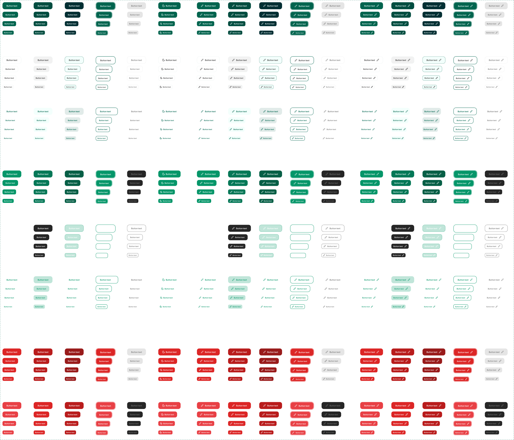</p>
<p align="center"><sub>Linhas: tipo (Primary, Secondary, Tertiary, Destructive) e tamanho. Colunas: ícone e estado.</sub></p>

| Figma | Valores | Sugestão de prop |
|---|---|---|
| `Type` | Primary · Secondary · Tertiary · Destructive | `variant: "primary" \| "secondary" \| "tertiary" \| "destructive"` |
| `Size` | Xlarge · Large · Medium · Small | `size: "xl" \| "lg" \| "md" \| "sm"` |
| `Icon` | None · Prefix · Suffix | `startIcon` / `endIcon` (slot) |
| `State` | Default · Hover · Focus · Disabled · Pressed · Loading | CSS + `disabled` + `loading` |
| `Text` | texto | `children` |
| `Dark mode` | False · True | tema |

**Medidas por tamanho** (medidas lidas do Figma, estado Default)

| Size | Altura | Padding (V × H) | Raio | Text style |
|---|---|---|---|---|
| Xlarge | 56 | 14 × 32 | `radius/xl` (18) | `Button/16 SemiBold` |
| Large | 48 | 12 × 24 | `radius/lg` (16) | `Button/14 SemiBold` |
| Medium | 40 | 10 × 16 | `radius/md` (12) | `Button/14 SemiBold` |
| Small | 32 | 6 × 12 | `radius/sm` (10) | `Button/12 SemiBold` |

Com ícone (`Prefix`/`Suffix`) o gap entre ícone e texto é de 12px no tamanho Medium (conferido no Figma; confirme nos outros tamanhos). No estado `Loading` o botão ganha um spinner, com gap de 8px.

**Tokens por tipo e estado**

| Tipo | Default | Hover | Pressed | Disabled | Focus |
|---|---|---|---|---|---|
| **Primary** | bg `primary` · texto `primary-foreground` | bg `primary-hover` | bg `primary-pressed` | bg `disabled` · texto `disabled-foreground` | anel 2px `primary` |
| **Secondary** | sem fundo · borda `border` · texto `foreground` | bg `muted` | bg `accent` · borda `primary` | borda `disabled` · texto `disabled-foreground` | anel 2px `primary` |
| **Tertiary** | sem fundo · texto `primary` | bg `accent` | bg `border` | texto `disabled-foreground` | borda 2px `primary` |
| **Destructive** | bg `destructive` · texto `destructive-foreground` | bg `destructive-hover` | bg `destructive-pressed` | bg `disabled` | anel 2px `destructive` |

```tsx
import { cva, type VariantProps } from "class-variance-authority";
import { Loader2 } from "lucide-react";

const button = cva(
  "inline-flex items-center justify-center font-heading font-semibold transition-colors " +
  "focus-visible:outline-none focus-visible:ring-2 disabled:pointer-events-none",
  {
    variants: {
      variant: {
        primary:
          "bg-primary text-primary-foreground hover:bg-primary-hover active:bg-primary-pressed " +
          "focus-visible:ring-primary disabled:bg-disabled disabled:text-disabled-foreground",
        secondary:
          "border border-border bg-transparent text-foreground hover:bg-muted " +
          "active:bg-accent active:border-primary focus-visible:ring-primary " +
          "disabled:border-disabled disabled:text-disabled-foreground",
        tertiary:
          "bg-transparent text-primary hover:bg-accent active:bg-border " +
          "focus-visible:ring-primary disabled:text-disabled-foreground",
        destructive:
          "bg-destructive text-destructive-foreground hover:bg-destructive-hover " +
          "active:bg-destructive-pressed focus-visible:ring-destructive " +
          "disabled:bg-disabled disabled:text-disabled-foreground",
      },
      size: {
        xl: "h-14 px-8 py-3.5 gap-3 rounded-xl text-base",
        lg: "h-12 px-6 py-3 gap-3 rounded-lg text-sm",
        md: "h-10 px-4 py-2.5 gap-3 rounded-md text-sm",
        sm: "h-8 px-3 py-1.5 gap-3 rounded-sm text-xs",
      },
    },
    defaultVariants: { variant: "primary", size: "xl" }, // o Figma usa Primary + Xlarge como padrão
  }
);

type ButtonProps = React.ButtonHTMLAttributes<HTMLButtonElement> &
  VariantProps<typeof button> & {
    loading?: boolean;
    startIcon?: React.ReactNode;
    endIcon?: React.ReactNode;
  };

export function Button({ variant, size, loading, startIcon, endIcon, children, disabled, className, ...props }: ButtonProps) {
  return (
    <button className={button({ variant, size, className })} disabled={disabled || loading} aria-busy={loading} {...props}>
      {loading ? <Loader2 className="size-4 animate-spin" aria-hidden /> : startIcon}
      {children}
      {endIcon}
    </button>
  );
}
```

```tsx
<Button>Agendar demonstração gratuita</Button>
<Button variant="secondary" size="md" startIcon={<Plus />}>Adicionar</Button>
<Button variant="destructive" size="md">Excluir</Button>
<Button loading>Enviando…</Button>
```

#### Icon button

[Abrir no Figma](https://www.figma.com/design/THYVm23rQLtJB4rxUKVMUl/RHLabs?node-id=18-82644) · 192 variantes

Botão só com ícone.

<p align="center">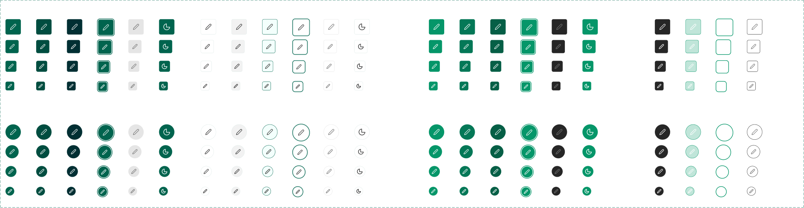</p>

| Figma | Valores | Sugestão de prop |
|---|---|---|
| `Type` | Primary · Secondary | `variant` |
| `Shape` | Square · Rounded | `shape: "square" \| "rounded"` |
| `Size` | Xlarge · Large · Medium · Small | `size` (56 · 48 · 40 · 32 px, quadrado) |
| `State` | Default · Hover · Focus · Disabled · Pressed · Loading | CSS |
| `Icon` | instance swap | `icon` |

`Rounded` usa `rounded-full`. `Square` usa raio 6px.
**Acessibilidade:** todo icon button precisa de `aria-label`.

---

### Formulários

Todos os campos compartilham as mesmas regras: rótulo claro acima do campo, placeholder curto, **feedback de validação visível e próximo do campo**, e obrigatoriedade sinalizada de forma consistente com `*`.

#### Input (Basic input)

[Abrir no Figma](https://www.figma.com/design/THYVm23rQLtJB4rxUKVMUl/RHLabs?node-id=18-77197) · 120 variantes

Recebe texto, e-mail, senha, busca e outros dados curtos.

<p align="center">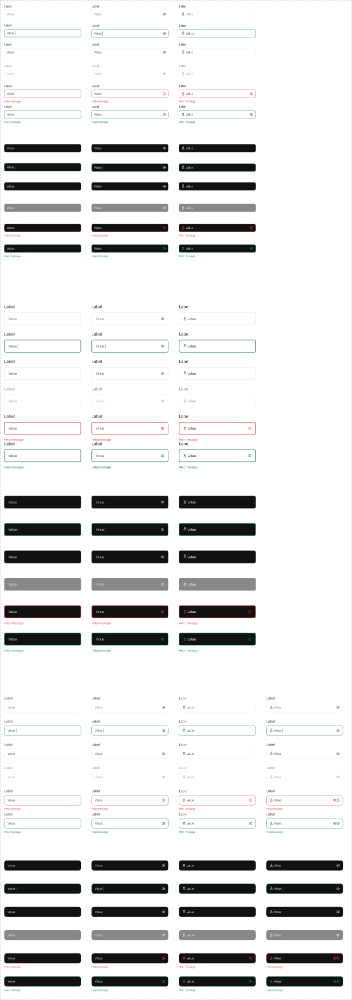</p>
<p align="center"><sub>Cada bloco é um tamanho (Medium, Large, Xlarge), primeiro Light e depois Dark. De cima para baixo: Default, Active, Completed, Disabled, Error e Success.</sub></p>

| Figma | Valores | Sugestão de prop |
|---|---|---|
| `Size` | Medium · Large · Xlarge | `size` |
| `State` | Default · Active · Completed · Disabled · Error · Success | foco por CSS · `disabled` · `error` · `success` |
| `Icon` | None · Prefix · Suffix · Both | `startIcon` / `endIcon` |
| `Label` / `Label text` | boolean / texto | `label` |
| `Help` / `Help text` | boolean / texto | `helpText` (mensagem de ajuda ou de erro) |
| `Mandatory` | boolean | `required` (mostra `*` em `destructive`) |
| `Placeholder text` | texto | `placeholder` |

**Medidas e tokens**

| Size | Altura do campo | Padding (V × H) | Raio | Texto do label | Texto do valor | Borda |
|---|---|---|---|---|---|---|
| Medium | 38 | 8 × 12 | 8px¹ | `Body/Small` | `Body/Small Regular` | 1px |
| Large | 48 | 8 × 16 | 12px (`radius/md`) | `Body/16 Regular` | `Body/Small Regular` | 1px |
| Xlarge | 60 | 8 × 20 | 8px¹ | `Body/20 Medium` | `Body/16 Regular` | 2px |

¹ Usam o token legado `radius-legacy/md`. Veja o [ponto de atenção #1](#8-pontos-de-atenção-leia-antes-de-implementar).

| Estado | Borda | Halo | Texto do valor |
|---|---|---|---|
| Default | `input` | , | `muted-foreground` (placeholder) |
| Active | `ring` | 3px `ring-focus` | `foreground` |
| Error | `destructive` | 3px `ring-error` | `foreground` |
| Success | `success` | , | `foreground` |
| Completed | `input` | , | `foreground` |
| Disabled | `input` | , | `foreground-secondary` |

Fundo do campo: `background`.

```tsx
export function Field({ label, helpText, error, required, ...props }: FieldProps) {
  const id = React.useId();
  return (
    <div className="flex flex-col gap-1.5">
      <label htmlFor={id} className="font-sans text-sm font-medium text-foreground">
        {label}{required && <span className="text-destructive"> *</span>}
      </label>
      <input
        id={id}
        aria-invalid={!!error}
        aria-describedby={helpText || error ? `${id}-help` : undefined}
        className={cn(
          "h-12 rounded-md border bg-background px-4 font-sans text-base text-foreground " +
          "placeholder:text-muted-foreground outline-none transition-shadow " +
          "border-input focus-visible:border-ring focus-visible:shadow-[0_0_0_3px_var(--ring-focus)] " +
          "aria-[invalid=true]:border-destructive aria-[invalid=true]:shadow-[0_0_0_3px_var(--ring-error)] " +
          "disabled:text-foreground-secondary"
        )}
        {...props}
      />
      {(helpText || error) && (
        <p id={`${id}-help`} className={cn("text-xs", error ? "text-destructive" : "text-muted-foreground")}>
          {error ?? helpText}
        </p>
      )}
    </div>
  );
}
```

**Regras:** rótulos claros e descritivos · placeholders curtos e fáceis de escanear · validação clara ("Nome inválido. Digite apenas letras.") · mesmo padrão `*` para obrigatório em todo o formulário · máscaras e validações básicas.

#### Tag input

[Abrir no Figma](https://www.figma.com/design/THYVm23rQLtJB4rxUKVMUl/RHLabs?node-id=18-77535)

Campo que mostra o valor como tag/opção. Há duas variantes no arquivo: uma com `Side = Right | Left` (20 variantes) e outra com ícone (`Icon` booleano, 10 variantes). Estados: Default · Active · Completed · Disabled · Error. Compartilha tokens e regras do Input.

<p align="center">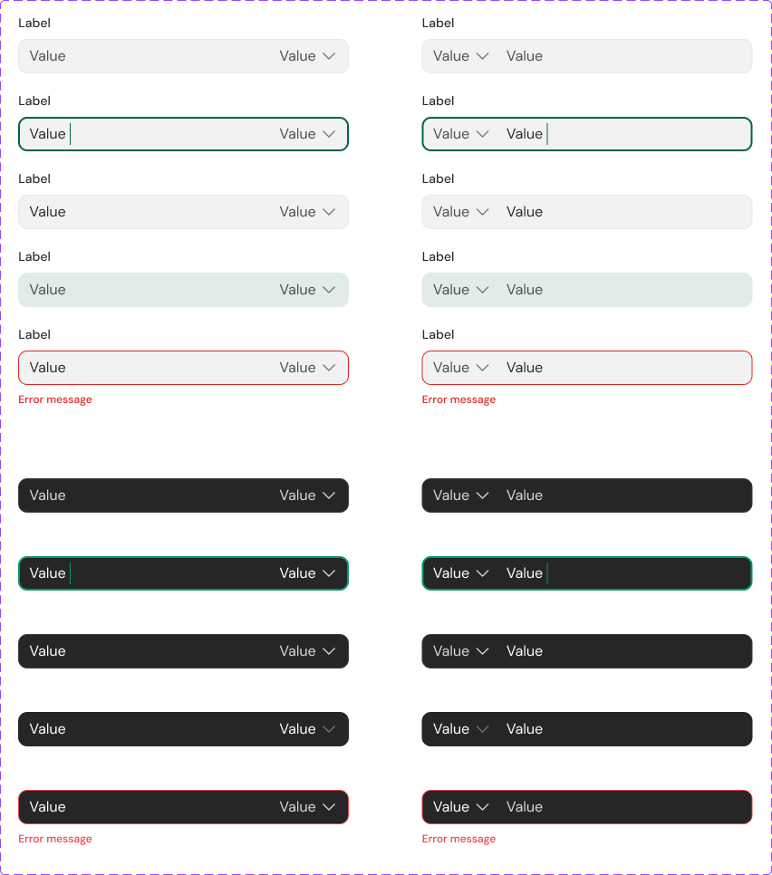</p>

#### Text area

[Abrir no Figma](https://www.figma.com/design/THYVm23rQLtJB4rxUKVMUl/RHLabs?node-id=26-131) · 12 variantes

Texto de várias linhas (comentários, justificativas, descrições). Mesmos estados, tokens e validação do Input.

<p align="center">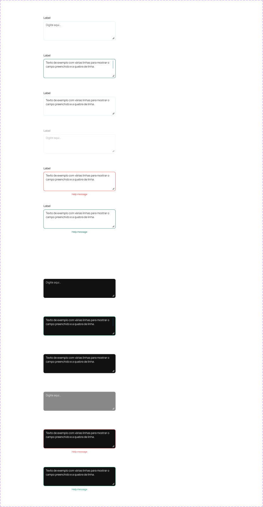</p>

| Figma | Valores |
|---|---|
| `State` | Default · Active · Completed · Disabled · Error · Success |
| `Label`, `Help`, `Mandatory` | booleanos |

- **Altura mínima de 96px**, com alça para redimensionar.
- Mostre o **limite de caracteres antes** de o usuário atingi-lo.
- Use só para respostas longas. Para respostas curtas, use Input.

#### Input selected (select)

[Abrir no Figma](https://www.figma.com/design/THYVm23rQLtJB4rxUKVMUl/RHLabs?node-id=29-131) · 24 variantes

Campo que abre uma lista de opções e mostra o valor escolhido. Mesmos estados e tokens do Input; `Size` = Medium · Large.

<p align="center">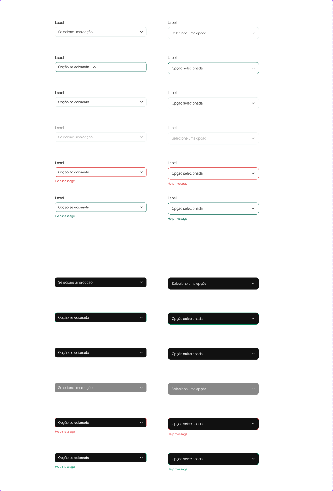</p>

- O valor escolhido fica **sempre visível** no campo; o chevron indica que abre uma lista.
- Teclado: abre com **Enter** ou **espaço**; setas navegam.
- Placeholder padrão: "Selecione uma opção".
- Para até 5 opções, prefira Radio ou Checkbox.

#### Dropdown

[Abrir no Figma](https://www.figma.com/design/THYVm23rQLtJB4rxUKVMUl/RHLabs?node-id=30-2112) · `Dropdown item` (8) e `Dropdown menu` (2)

Menu suspenso para escolher uma ação ou opção.

<p align="center">
  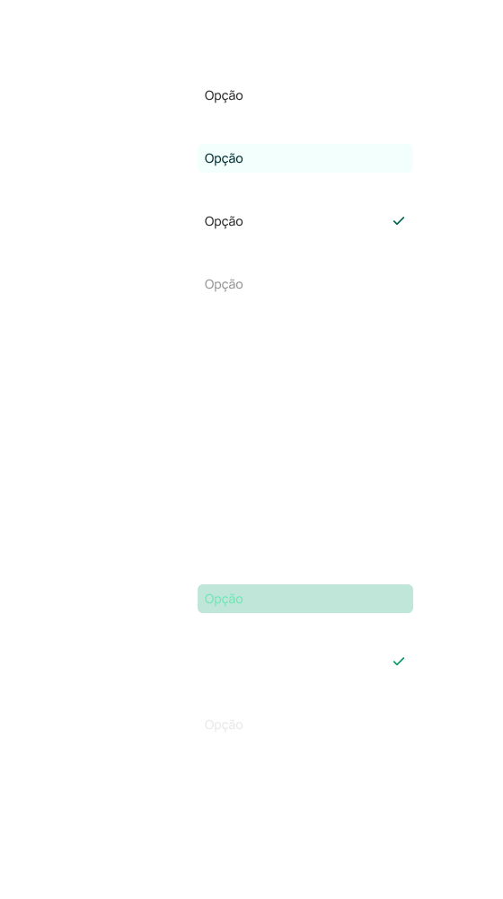
  &nbsp;&nbsp;
  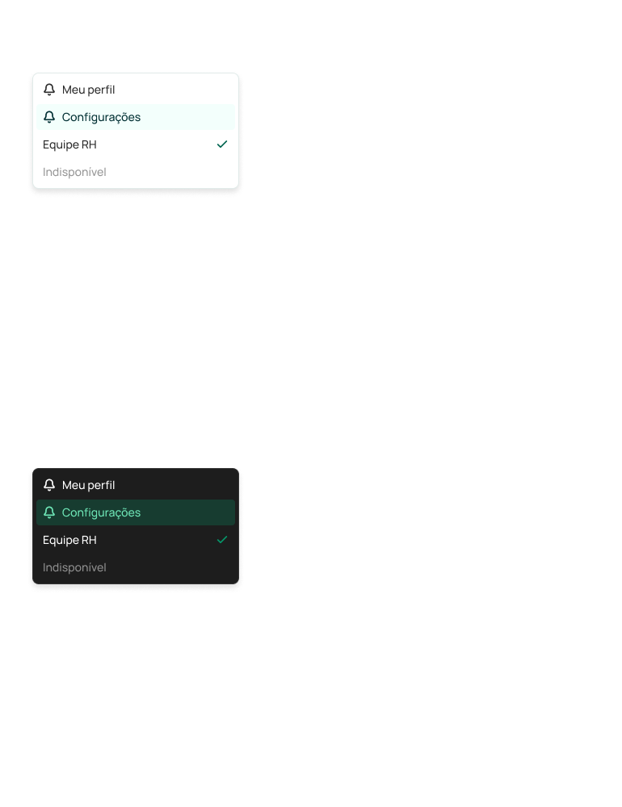
</p>

| Figma | Valores | Sugestão de prop |
|---|---|---|
| `Dropdown item` / `State` | Default · Hover · Selected (com check) · Disabled | `selected`, `disabled` |
| `Label` | texto | `children` |
| `Leading icon` | boolean | `icon` |

- Fundo do menu: `popover` (texto `popover-foreground`). Confira o raio e o espaçamento interno direto no Figma.
- **Teclado:** setas navegam, **Enter** seleciona, **Esc** fecha.
- Agrupe opções relacionadas com separadores · itens curtos e alinhados à esquerda · marque o selecionado com **check, além da cor** · desabilite itens indisponíveis em vez de escondê-los · evite mais de 7 itens (use busca ou agrupamento).

> Dica de implementação: use o `Select` / `DropdownMenu` do shadcn/ui (Radix) e aplique os tokens acima. Ele já resolve o teclado e o foco.

#### Checkbox

[Abrir no Figma](https://www.figma.com/design/THYVm23rQLtJB4rxUKVMUl/RHLabs?node-id=11-350) · 12 variantes

Estilo shadcn/ui: caixa de **18px** (a descrição do componente no Figma diz 16px, mas a caixa desenhada tem 18px; o código segue 18px), **raio 4px**.

<p align="center">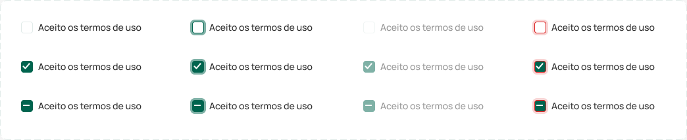</p>

| Figma | Valores | Sugestão de prop |
|---|---|---|
| `Checked` | unchecked · checked · indeterminate | `checked: boolean \| "indeterminate"` |
| `State` | Default · Focus · Disabled · Error | CSS · `disabled` · `aria-invalid` |
| `Show label` / `Label` | boolean / texto | `label` |

Use para seleção múltipla ou escolha binária isolada ("Aceito os termos de uso"). **Checkbox vs Toggle:** use Checkbox quando a ação exige um botão de confirmação depois (ex.: formulário de envio).

#### Radio Button

[Abrir no Figma](https://www.figma.com/design/THYVm23rQLtJB4rxUKVMUl/RHLabs?node-id=1-11475) · 24 variantes

Escolhe **uma** opção entre várias.

<p align="center">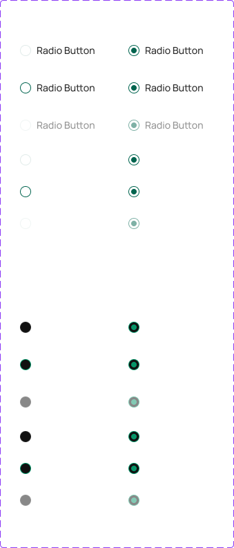</p>

| Figma | Valores |
|---|---|
| `Status` | Default · Hover · Disabled |
| `Checked` | False · True |
| `Label` | True · False |

A página Radio agrupa mais quatro componentes de escolha única:

| Componente | Link | Props principais |
|---|---|---|
| **Choice chip** | [Figma](https://www.figma.com/design/THYVm23rQLtJB4rxUKVMUl/RHLabs?node-id=100-10) | `Selected` (bool) · `Label text` (ex.: "1-20", faixa de colaboradores) |
| **Radio card** | [Figma](https://www.figma.com/design/THYVm23rQLtJB4rxUKVMUl/RHLabs?node-id=100-29) | `Selected` (bool) · `Label text` (ex.: "Controle de ponto") |
| **Segmented control** | [Figma](https://www.figma.com/design/THYVm23rQLtJB4rxUKVMUl/RHLabs?node-id=104-64) | `Shape` Default/Pill · `Style` Soft/Solid · `Options` 2/3 · `Selected` 1/2/3 · textos das opções |
| **Stepper** | [Figma](https://www.figma.com/design/THYVm23rQLtJB4rxUKVMUl/RHLabs?node-id=104-155) | `Current` 1/2/3 · `Size` Default/Small · nome dos 3 passos (cadastro: "Responsável / gestor", "Dados da empresa", "Planos") |

**Choice chip**

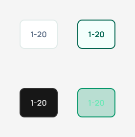

**Radio card**

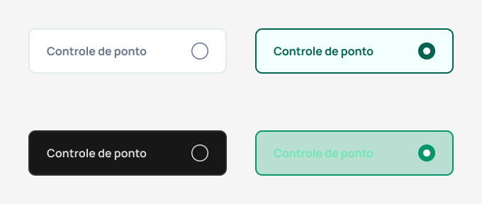

**Segmented control**

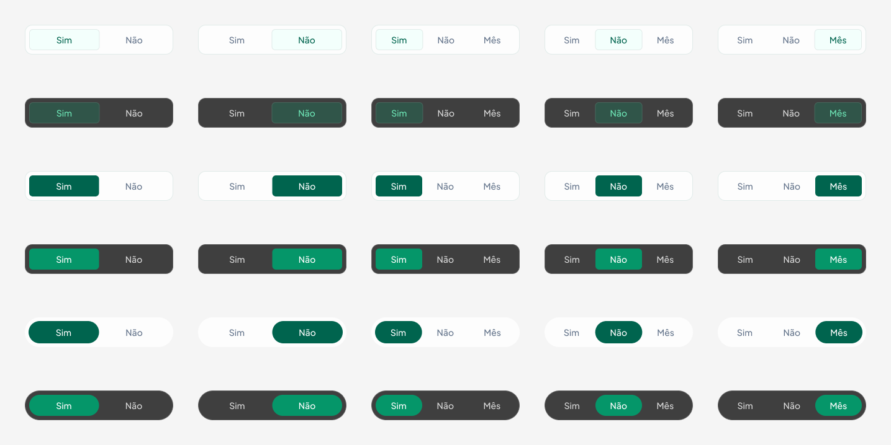

**Stepper**

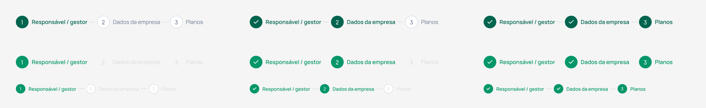


Radio, Choice chip, Radio card e Segmented control seguem o padrão `radiogroup` (setas navegam, `role` e `aria-checked` corretos). O Stepper é indicador de progresso, não é controle de escolha: use `aria-current="step"` na etapa atual.

---

### Feedback e dados

#### Status

[Abrir no Figma](https://www.figma.com/design/THYVm23rQLtJB4rxUKVMUl/RHLabs?node-id=181-88) · `Status` (v2) · 30 variantes

Indicador do estado de um registro (aprovado, pendente, erro…). **Combina cor, ponto e texto**; nunca depende só da cor.

<p align="center">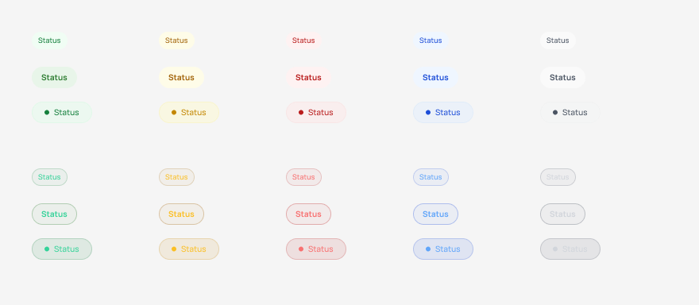</p>
<p align="center"><sub>Colunas: Success, Warning, Error, Info, Neutral. Linhas: Tag, Pill e Dot (Light em cima, Dark embaixo).</sub></p>

| Figma | Valores | Sugestão de prop |
|---|---|---|
| `Type` | Success · Warning · Error · Info · Neutral | `type` |
| `Style` | Tag (22px de altura) · Pill (27px) · Dot (27px) | `appearance` (não use `style`: colide com a prop do React) |
| `Label` | texto | `children` |

Mapeamento de cor **sugerido** (confirme as cores exatas no Figma): Success → `success` · Warning → `warning` · Error → `destructive` · Info → `info` · Neutral → `muted`.

- Rótulos curtos, de uma ou duas palavras: *Aprovado*, *Pendente*, *Reprovado*.
- Mesmo tipo para o mesmo significado em todas as telas. **Não crie status novos**, reaproveite.
- Contraste mínimo de **4.5:1** entre texto e fundo.
- `Status (antigo)` ([Figma](https://www.figma.com/design/THYVm23rQLtJB4rxUKVMUl/RHLabs?node-id=31-1035)) ainda existe no arquivo. **Não implemente.**

#### Badge

[Abrir no Figma](https://www.figma.com/design/THYVm23rQLtJB4rxUKVMUl/RHLabs?node-id=11-403) · 7 variantes

Rótulo curto de status ou categoria, no estilo shadcn/ui.

<p align="center">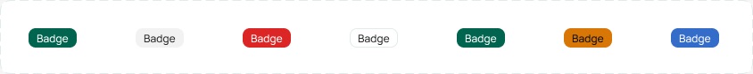</p>

| Figma `Variant` | Quando usar |
|---|---|
| `default` | Destaque neutro de marca |
| `secondary` | Categoria discreta |
| `destructive` | Erro / risco |
| `outline` | Contorno, sem preenchimento |
| `success` · `warning` · `info` | Estados do RHLabs: aprovado, pendente, informativo |

**Badge ou Status?** Badge é categoria/contagem. Status é o estado de um registro (com ponto).

#### Rating

[Abrir no Figma](https://www.figma.com/design/THYVm23rQLtJB4rxUKVMUl/RHLabs?node-id=1-9556) · `Rating` (84) e `Rating Item` ([Figma](https://www.figma.com/design/THYVm23rQLtJB4rxUKVMUl/RHLabs?node-id=1-9519), 12)

| Figma | Valores |
|---|---|
| `Dispositivo` | Desktop · Mobile |
| `Tamanho` | sm · md · lg |
| `Estilo` | Preenchida · Contornada |
| `Valor` | 0 a 5 |
| `Rating Item` / `State` | Empty · Half · Full |

<p align="center">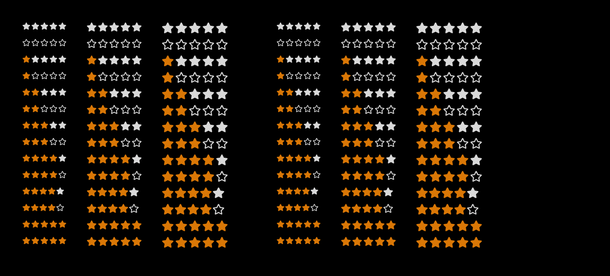</p>

Valores de 0 a 5 em passos de **0,5** (o item `Half` faz a meia estrela). A página indica três contextos de uso: tabelas e cards compactos, card de produto e cabeçalhos, e rating de entrada em formulário. Confira no Figma qual tamanho (`sm`/`md`/`lg`) corresponde a cada um. Pode vir com nota, contagem ("1.159 avaliações verificadas") e histograma.
**Evite misturar** os estilos preenchido e contornado na mesma avaliação.

#### Avatar

[Abrir no Figma](https://www.figma.com/design/THYVm23rQLtJB4rxUKVMUl/RHLabs?node-id=1-11694) · 56 variantes

Representa usuário, equipe ou perfil.

<p align="center">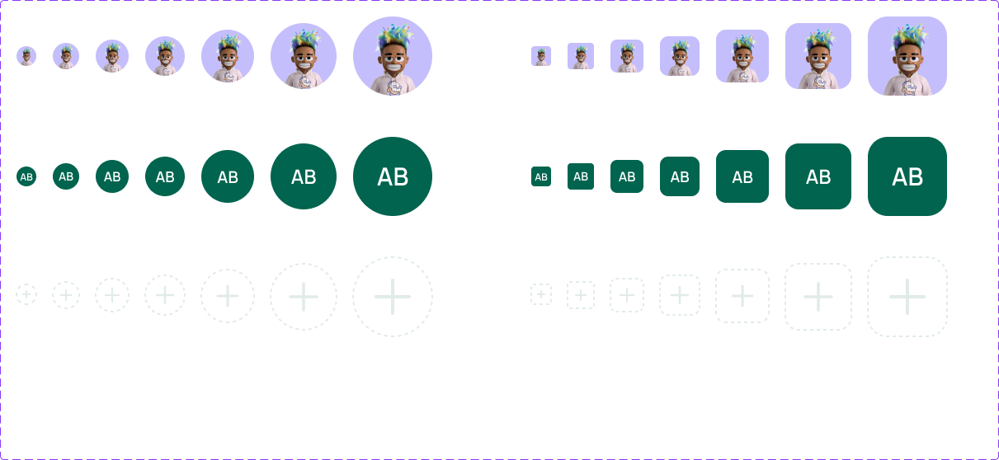</p>

| Figma | Valores |
|---|---|
| `Type` | Image · Text (iniciais, quando não há foto) |
| `Size` | 2xl · 3xl · 4xl · 5xl · 6xl · 7xl · 8xl |
| `Format` | Circle · squircle |
| `Status` | Default · placeholder (sem imagem) |

Sempre inclua `alt` na imagem e, no modo texto, as iniciais do nome.

---

### Navegação e conteúdo

#### Accordion item

[Abrir no Figma](https://www.figma.com/design/THYVm23rQLtJB4rxUKVMUl/RHLabs?node-id=108-21534) · 8 variantes

Usado nas FAQs da landing. `State` = Closed · Open, `Size` = Default · Compact, com `Question` e `Answer`. Use o Accordion do shadcn/ui (Radix) para teclado e `aria-expanded`.

<p align="center">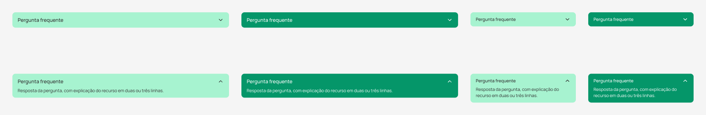</p>

#### Nav link

[Abrir no Figma](https://www.figma.com/design/THYVm23rQLtJB4rxUKVMUl/RHLabs?node-id=109-19) · 6 variantes

Link do menu de navegação do site. `State` = Default · Hover · Selected. O selecionado leva `aria-current="page"`.

<p align="center">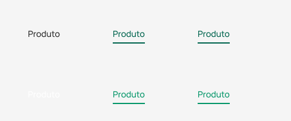</p>

---

### Componentes do App

Página [Componentes do App](https://www.figma.com/design/THYVm23rQLtJB4rxUKVMUl/RHLabs?node-id=238-2): blocos reutilizáveis do portal do colaborador e dos fluxos de cadastro/KYC. Todos têm `Dark mode`.

| Componente | Figma | O que é | Props principais |
|---|---|---|---|
| **Icon tile** | [↗](https://www.figma.com/design/THYVm23rQLtJB4rxUKVMUl/RHLabs?node-id=238-123) | Ícone sobre fundo tonal | `Tone`: Brand · Warning · Error · Info · Success · `Size`: Small · Medium · Large · XLarge · `Icon` |
| **Info row** | [↗](https://www.figma.com/design/THYVm23rQLtJB4rxUKVMUl/RHLabs?node-id=238-135) | Linha com ícone, rótulo e valor | `Icon` · `Label` · `Value` (largura **Fill**) |
| **Progress bar** | [↗](https://www.figma.com/design/THYVm23rQLtJB4rxUKVMUl/RHLabs?node-id=238-203) | Barra de progresso | `Value` 0 a 100 em passos de 10 (largura **Fill**) |
| **Step item** | [↗](https://www.figma.com/design/THYVm23rQLtJB4rxUKVMUl/RHLabs?node-id=238-243) | Etapa de passo a passo vertical | `State`: Done · Current · Todo · `Title` · `Description` · `Number` |
| **Code box** | [↗](https://www.figma.com/design/THYVm23rQLtJB4rxUKVMUl/RHLabs?node-id=238-257) | Um dígito do código de verificação | `State`: Empty · Filled · Active · Error. Use **6 em linha**, com Fill e gap de 8 (mobile) ou 12 (desktop) |
| **Option card** | [↗](https://www.figma.com/design/THYVm23rQLtJB4rxUKVMUl/RHLabs?node-id=239-146) | Opção selecionável com ícone, título e descrição | `Selected` · `Trailing`: Chevron · Badge · None · `Title` · `Description` |
| **File upload** | [↗](https://www.figma.com/design/THYVm23rQLtJB4rxUKVMUl/RHLabs?node-id=239-170) | Envio de evidência (estilo upload do KYC) | `State`: Default · Filled · textos de ação, dica, ajuda e nome do arquivo |
| **Modal header** | [↗](https://www.figma.com/design/THYVm23rQLtJB4rxUKVMUl/RHLabs?node-id=239-196) | Cabeçalho de modal com título, fechar e divisor | `Size`: Mobile (375) · Desktop (650) · `Title` |
| **Document row** | [↗](https://www.figma.com/design/THYVm23rQLtJB4rxUKVMUl/RHLabs?node-id=239-220) | Linha de documento | `Name` · `Subtitle` · `Show status` · `Show action` |
| **Stat card** | [↗](https://www.figma.com/design/THYVm23rQLtJB4rxUKVMUl/RHLabs?node-id=239-236) | Cartão de indicador (ícone, valor, rótulo) | `Value` · `Label` (tom no Icon tile interno) |
| **Alert** | [↗](https://www.figma.com/design/THYVm23rQLtJB4rxUKVMUl/RHLabs?node-id=241-7411) | Alerta do app com ícone e mensagem | `Tone`: Info · Warning · Error · Success · `Message` · `Icon` (largura **Fill**) |
| **Check item** | [↗](https://www.figma.com/design/THYVm23rQLtJB4rxUKVMUl/RHLabs?node-id=241-7487) | Item de checklist (regras de senha, benefícios) | `State`: Met · Unmet · `Size`: Small (12) · Medium (14) · `Label` |

<details open>
<summary><strong>Galeria dos componentes do App</strong></summary>

**Icon tile** (tons Brand, Warning, Error, Info e Success em 4 tamanhos)

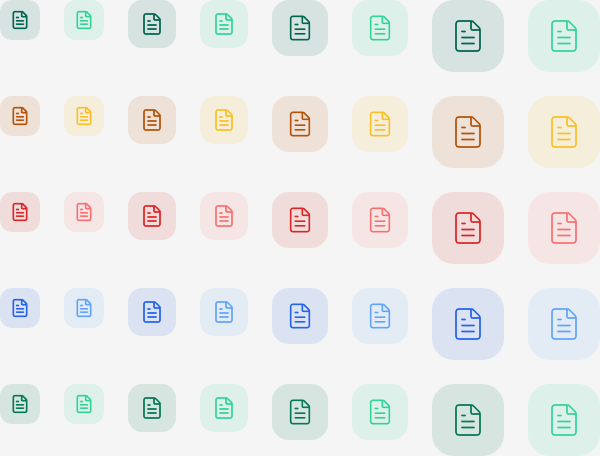

**Info row**

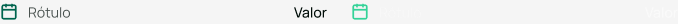

**Step item**

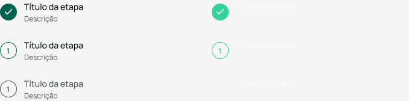

**Code box**

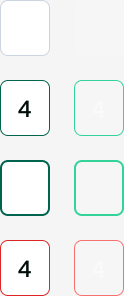

**Option card**

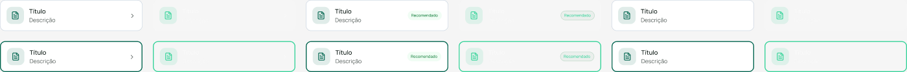

**File upload**

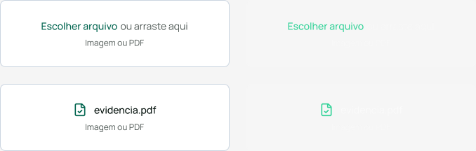

**Modal header**

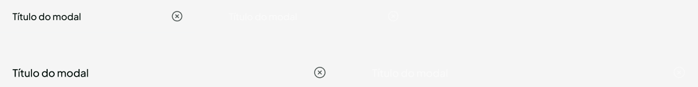

**Document row**

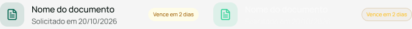

**Stat card**

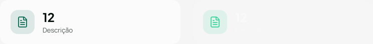

**Alert**

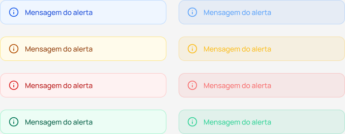

**Check item**

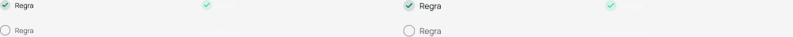

O `Progress bar` ([Figma](https://www.figma.com/design/THYVm23rQLtJB4rxUKVMUl/RHLabs?node-id=238-203)) é uma faixa fina de 11 valores (0 a 100) e não rende em print: abra no Figma.

</details>

Exemplos:

```tsx
<Alert tone="warning" icon={<TriangleAlert />}>Suas férias vencem em 30 dias.</Alert>
<ProgressBar value={60} />
<div className="flex gap-2 md:gap-3">{digits.map((d, i) => <CodeBox key={i} state={...} digit={d} />)}</div>
<CheckItem state={hasMin8 ? "met" : "unmet"} size="sm">Mínimo de 8 caracteres</CheckItem>
```

> Padrão para tom/semântica: `Tone` ou `Type` usam sempre o mesmo mapeamento de cor (Success → `success`, Warning → `warning`, Error → `destructive`, Info → `info`, Brand → `primary`).

---

### Componentes de layout

Página [Layout](https://www.figma.com/design/THYVm23rQLtJB4rxUKVMUl/RHLabs?node-id=242-3798): estrutura das páginas do site e do app. Todos têm Light e Dark e usam a coleção `Header e Footer`.

| Componente | Figma | Descrição | Variações |
|---|---|---|---|
| **Site header** | [↗](https://www.figma.com/design/THYVm23rQLtJB4rxUKVMUl/RHLabs?node-id=243-22449) | Cabeçalho do site (desktop 1440 × 96): logo, links, tema, "Entrar" e "Começar agora". O mobile usa o `Header mobile` (página App Components) | `Dark mode` |
| **Site footer** | [↗](https://www.figma.com/design/THYVm23rQLtJB4rxUKVMUl/RHLabs?node-id=243-21499) | Rodapé da landing e das páginas legais | `Layout`: Desktop (1440) · Mobile (375) |
| **App sidebar** | [↗](https://www.figma.com/design/THYVm23rQLtJB4rxUKVMUl/RHLabs?node-id=242-12740) | Menu lateral do app (desktop). Aberto 253px ou recolhido 94px (só ícones). Altura **Fill** | `Open`: True/False · `Active`: Home · Ponto · Docs · Holerite · Férias · None · `Name` · `Role` |
| **Page header** | [↗](https://www.figma.com/design/THYVm23rQLtJB4rxUKVMUl/RHLabs?node-id=243-5630) | Cabeçalho verde das páginas do app: título, subtítulo, botão de tema e notificações. Largura **Fill** | `Title` · `Subtitle` |
| **App bottom menu** | [↗](https://www.figma.com/design/THYVm23rQLtJB4rxUKVMUl/RHLabs?node-id=243-15761) | Menu inferior do app mobile (375 × 66) com botão central **Férias** | `Active`: Home · Ponto · Docs · Holerite · Férias |
| **Help banner** | [↗](https://www.figma.com/design/THYVm23rQLtJB4rxUKVMUl/RHLabs?node-id=242-3844) | Faixa de contato das páginas legais ("Dúvidas sobre a privacidade?"), usa `cta/*` | `Layout`: Desktop (916) · Mobile (353) |
| **Help card** | [↗](https://www.figma.com/design/THYVm23rQLtJB4rxUKVMUl/RHLabs?node-id=242-3857) | Cartão lateral de contato (LGPD, Cookies, Termos), usa `card/*` | `Dark mode` |

<details open>
<summary><strong>Galeria dos componentes de layout</strong></summary>

**Site header** (desktop 1440 × 96)

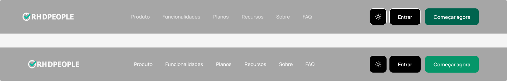

**Site footer** (Desktop e Mobile, Light e Dark)

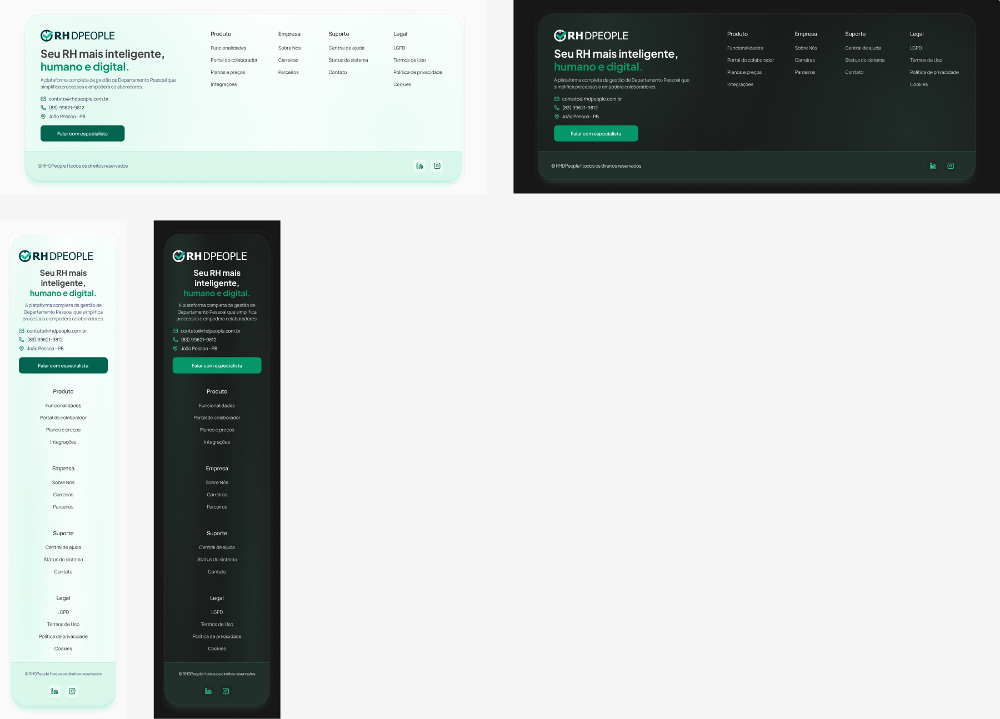

**App sidebar** (aberta e recolhida)

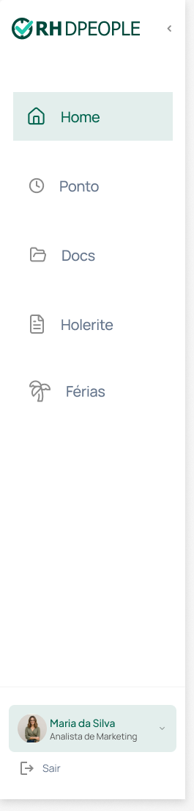
&nbsp;&nbsp;
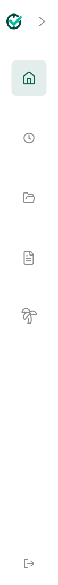

Na imagem aparece apenas a seção `Home` ativa, em Light. Todas as seções e o Dark estão no Figma.

**Page header**

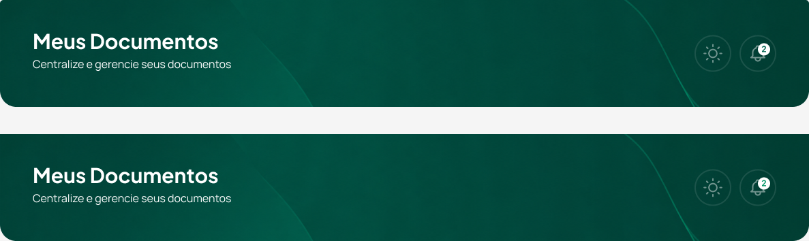

**App bottom menu** (mobile)

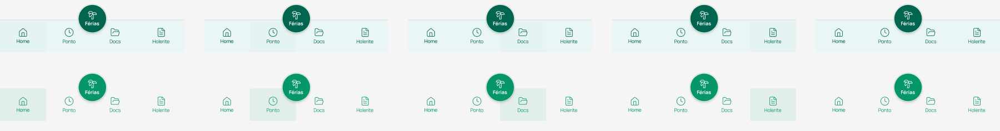

**Help banner**

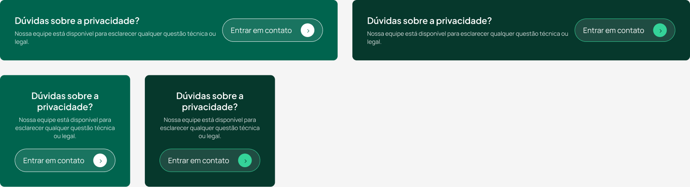

**Help card**

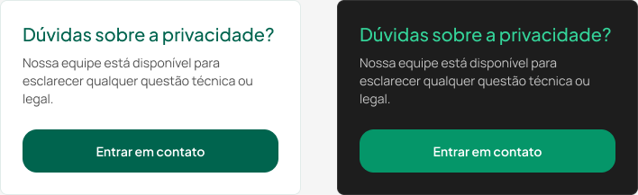

</details>

**Navegação responsiva do app:** desktop usa `App sidebar` (aberta ou recolhida) e mobile usa `App bottom menu`. A seção ativa é a mesma nos dois (Home, Ponto, Docs, Holerite, Férias), então centralize isso em uma única fonte de rotas.

```tsx
const nav = [
  { key: "home", label: "Home", href: "/", icon: Home },
  { key: "ponto", label: "Ponto", href: "/ponto", icon: Clock },
  { key: "docs", label: "Docs", href: "/documentos", icon: FileText },
  { key: "holerite", label: "Holerite", href: "/holerites", icon: Receipt },
  { key: "ferias", label: "Férias", href: "/ferias", icon: Palmtree },
]; // alimenta Sidebar e BottomMenu
```

> Os ícones acima são ilustrativos. Confirme o ícone exato de cada item no Figma.

---

## 7. Acessibilidade

Regras repetidas nas páginas do Figma, reunidas aqui:

| Regra | Como aplicar |
|---|---|
| **Contraste mínimo 4.5:1** entre texto e fundo | Use os pares `*` / `*-foreground` do Theme; não misture pares |
| **Foco sempre visível** | Anel/halo de foco em todo controle (`:focus-visible`), nunca `outline: none` sem substituto |
| **Estado nunca só por cor** | Erro com mensagem de texto (e ícone), seleção com check, status com ponto e texto |
| **Teclado completo** | Dropdown/Select: setas, Enter, Esc. Radio: setas. Accordion: Enter/espaço |
| **Rótulo em todo campo** | `<label htmlFor>` sempre. Placeholder não substitui rótulo |
| **Erro associado ao campo** | `aria-invalid` + `aria-describedby` apontando para a mensagem |
| **Ícones decorativos escondidos** | `aria-hidden`; ícone sozinho em botão precisa de `aria-label` |
| **Imagens** | `alt` em Avatar e logo |

---

## 8. Pontos de atenção (leia antes de implementar)

Inconsistências encontradas ao ler o arquivo. Nenhuma impede de implementar, mas é bom o time saber o que é oficial e o que é resíduo. Itens marcados como **Design** precisam de decisão de quem mantém o Figma.

| # | Tema | O que acontece | Como agir no código | Dono |
|---|---|---|---|---|
| 1 | **Escala de raio** | A página *Border Radius* mostra a escala antiga (xs=2, sm=6, md=8, lg=10, xl=14, 2xl=18, 3xl=24). A coleção `Radius` e os botões usam a nova (2xs=4, xs=8, sm=10, md=12, lg=16, xl=18). O Input `Medium` e `Xlarge` ainda aponta para `radius-legacy/md` (8px) e o Input `Large` para `radius/md` (12px). | Use a **coleção `Radius`** (seção 5.4). Para Input, siga as medidas do Figma até o design alinhar. | Design |
| 2 | **Verde da marca** | A página *Colors* mostra a escala `green` (ex.: 700 = `#006753`). O `Theme` aponta para `brand/green-*` (700 = `#00644E`). Os dois verdes são parecidos, mas não iguais. | Use **sempre os tokens do `Theme`** (`--primary`). Nunca copie hex da escala `green`. | Design |
| 3 | **Cores soltas** | A coleção `Primitives` guarda ~130 cores `extra/*` (hex avulsos). | **Não use.** Só entra o que existe no Theme. | Design |
| 4 | **Coleções legadas** | Cinco coleções `Legacy / …` seguem no arquivo para não quebrar telas antigas. | Ignore. | Design |
| 5 | **Muitos text styles** | Há 100+ styles; só ~20 são semânticos (seção 5.3). | Use os semânticos; os demais só onde a ficha do componente mandar. | Design |
| 6 | **Grid** | Max-width desktop aparece como 1440 (cards) e 1280 (tabela de breakpoints). Gutter do tablet não está explícito. | Use 1440 como `max-w` do container e 1280 como breakpoint de referência. Confirme com o design. | Design |
| 7 | **Escala de espaço no Grid** | A página Grid mostra `SPACE-XS…5XL` (16, 24, 32, 48, 64, 80, 96, 128). A página Spacing usa a escala de 4px do Tailwind. | A escala de 4px é a base; a do Grid é um subconjunto para seções. | Design |
| 8 | **Tipos nos nomes de propriedade** | `Paceholder text`, `Mandantory`, `placehoder`, `Defolt`, `Desatovado`, `Tipography`. | Corrija na hora de criar props (`placeholder`, `required`). Não replique os typos. | Design |
| 9 | **Página "App Components"** | Contém peças das telas (FAQ, seções da landing, protótipo interativo) com nomes genéricos (`Property 1`, `Variant2`). É anterior ao sistema atual. | Para blocos novos, use *Componentes do App* e *Layout*. Consulte *App Components* só como referência de tela. | Design |
| 10 | **Status antigo** | `Status (antigo)` convive com o `Status` v2. | Implemente só o v2. | Design |
| 11 | **Raio do Icon button** | O quadrado usa 6px, valor que não está na escala atual. | Use `rounded-[6px]` ou aguarde alinhamento. | Design |
| 12 | **Nome do produto** | Aparece como RHLabs, RHDPeople e RhDPeople. | Use o nome definido pelo produto/marketing nos textos de interface. | Produto |
| 13 | **Status e Alert fora dos tokens** | As cores de `Status` e `Alert` são hex soltos e escalas (`extra/*`, `red/700`…), não tokens do Theme. | O código fixa os valores lidos do Figma. Se o Theme ganhar tokens para isso, trocar. | Design |
| 14 | **Texto do Status muito pequeno** | Tag tem 9px e Pill/Dot têm 10px, abaixo do mínimo recomendado de leitura. | Implementado como no Figma. Avaliar aumento. | Design |
| 15 | **Accordion com cor própria** | Em Light usa `brand/green-200` sólido (`#A7F3D0`) e em Dark usa `primary`, sem token semântico. | Implementado com `--accordion-bg` e `--accordion-foreground` em `tokens.css`. | Design |
| 16 | **Raios e medidas soltos** | Textarea, Dropdown menu e Badge usam `radius-legacy/*`; Checkbox tem descrição de 16px e caixa de 18px; Icon button quadrado usa 6px. | O código segue as medidas desenhadas (ver ponto 1). | Design |

---

## 9. Checklist para implementar um componente

Antes de abrir o PR, confira:

- [ ] Abri o componente no Figma e conferi **todas as variantes** (inclusive Dark).
- [ ] Cores vêm **só de tokens do Theme**. Nenhum hex no componente.
- [ ] Espaçamentos e raios vêm das escalas (`p-4`, `rounded-md`).
- [ ] Tipografia usa um **text style semântico** (família, peso, tamanho e line-height corretos).
- [ ] Estados `hover`, `focus-visible`, `active`, `disabled` (e `loading`/`error` quando existirem) estão cobertos por CSS.
- [ ] **Dark mode** testado: sem hex, sem prop `dark`.
- [ ] Teclado: Tab, Enter/Espaço, setas e Esc funcionam como a ficha descreve.
- [ ] `label`, `aria-*` e `alt` corretos (seção 7).
- [ ] Contraste ≥ 4.5:1 nos dois temas.
- [ ] Props nomeadas pelo padrão da seção 4.3 e documentadas.
- [ ] Testei em **375px, 768px e 1440px**.
- [ ] Se o Figma e o README divergirem, atualizei o README ou abri issue.

---

## 10. Governança e equipe

### Como contribuir

1. **Dúvida ou divergência com o Figma?** Abra uma issue neste repositório com o link do componente (botão direito → *Copy link to selection*).
2. **Quer um novo componente ou token?** Peça ao design antes de implementar. O Figma é a origem; o código acompanha.
3. **PR de componente:** use o checklist da seção 9.
4. **Encontrou problema ou oportunidade de melhoria?** Compartilhe com a equipe. O sistema evolui de forma colaborativa.

### Regras do arquivo Figma

Vindas da página *Rules*, valem para quem edita o arquivo:

- Edição apenas pela **conta oficial da comunidade** (não use contas pessoais).
- É proibido compartilhar credenciais com pessoas externas ou não autorizadas.
- Não exclua páginas, componentes ou bibliotecas sem alinhar com a equipe responsável. Mudanças estruturais são avisadas antes.
- Mantenha tudo organizado seguindo o Design System.
- Não altere senhas, configurações da conta ou permissões sem autorização da liderança.

### Equipe

Responsável por estruturar, documentar e evoluir o Design System: **Laboratório LABS**.

| Pessoa | Papel |
|---|---|
| Talessa Rodrigues | Product Designer |
| Anne | UX/UI Designer |
| Herlisson | , |

---

<sub>Versão 1.0 do Design System · documentação gerada a partir do arquivo Figma RHLabs (abril de 2026). Valores de cor, tipografia, raio e medidas dos botões e inputs foram lidos diretamente das variáveis e dos componentes do arquivo.</sub>
